# Complete Project Architecture Diagrams

## Disaster streaming, evidence analysis, graph intelligence, and operations dashboard

This document provides a visual architecture reference for the complete
repository. The first Mermaid diagram is the master system diagram. The
remaining diagrams isolate important flows so they remain readable in a
presentation.

The diagrams represent the current implementation, including:

- ordinary dataset producers and controlled scenario replay;
- SHA-256/pHash deduplication;
- Kafka and MinIO;
- Spark Structured Streaming;
- drone/YOLO analysis;
- universal satellite normalization and broad-area classification;
- social report review;
- GIS association, temporal graph state, and TGNN ranking;
- scenario-isolated durable dashboard state;
- manual building classification;
- process controls, readiness, and authorization; and
- the architectural boundaries between evidence types.

---

## 1. Master end-to-end architecture

```mermaid
flowchart TB
    %% ------------------------------------------------------------------
    %% Sources and scenario definition
    %% ------------------------------------------------------------------
    subgraph L0["Layer 0 - External evidence and registered scenario assets"]
        CRISIS["CrisisMMD<br/>social TSV"]
        ISBDA["ISBDA<br/>drone JPEG"]
        SATDATA["SpaceNet 8 / xBD<br/>PRE and POST TIFF"]
        GISMEDIA["GIS map media<br/>JPG / PNG"]
        OSM["Frozen OSM-derived GeoJSON<br/>roads / buildings / infrastructure"]
        FIELD["Future field gateways<br/>drone / satellite / sensors / social"]
        PACKAGES["Scenario packages<br/>Louisiana flood / Mexico earthquake"]
        REGISTRY["Scenario registry<br/>ID / package / map bounds / dataset roots"]
    end

    subgraph SCENARIO["Scenario orchestration - input timing, not final-result injection"]
        VALIDATE["Strict scenario validator<br/>hash / path / footprint / provenance / target IDs"]
        CLOCK["Scenario controller<br/>start / pause / resume / reset / speed<br/>monotonic clock + replay ID"]
        FACTORY["Scenario event factory<br/>production-shaped events<br/>real + simulated field disclosure"]
        DISPATCH["Kafka dispatcher<br/>routes only input milestones"]
    end

    REGISTRY --> PACKAGES
    PACKAGES --> VALIDATE --> CLOCK --> FACTORY --> DISPATCH
    ISBDA -. "registered source bytes" .-> FACTORY
    SATDATA -. "registered source bytes" .-> FACTORY
    CRISIS -. "registered source/report evidence" .-> FACTORY

    %% ------------------------------------------------------------------
    %% Producer and shared upstream services
    %% ------------------------------------------------------------------
    subgraph L1["Layer 1 - Source adapters and upstream preprocessing"]
        SOCIALP["Social producer<br/>TSV row standardization"]
        DRONEP["Drone producer<br/>decode JPEG + event envelope"]
        SATP["Satellite producer<br/>TIFF decode + JPEG transport copy"]
        GISP["GIS media producer<br/>decode map image"]
        TELEMP["Telemetry adapter<br/>validate state-update contract"]
        DEDUP["Persistent image deduplication<br/>SHA-256 exact + source-aware pHash<br/>SQLite WAL fingerprint ledger"]
        TRANSFER["ImageTransfer<br/>Base64 fallback or object reference"]
    end

    CRISIS --> SOCIALP
    ISBDA --> DRONEP
    SATDATA --> SATP
    GISMEDIA --> GISP
    FIELD --> SOCIALP
    FIELD --> DRONEP
    FIELD --> SATP
    FIELD --> TELEMP
    FACTORY --> SOCIALP
    FACTORY --> DRONEP
    FACTORY --> SATP
    FACTORY --> TELEMP
    DRONEP --> DEDUP
    SATP --> DEDUP
    GISP --> DEDUP
    DEDUP --> TRANSFER

    %% ------------------------------------------------------------------
    %% Transport and storage
    %% ------------------------------------------------------------------
    subgraph L2["Layer 2 - Transport and evidence storage"]
        MINIO[("MinIO / S3-compatible object storage<br/>bucket: disaster-images<br/>checksum-derived object keys")]
        KAFKA[("Kafka broker<br/>three partitions per application topic")]
        ZK["ZooKeeper<br/>local Kafka coordination"]

        TSOC["social-posts"]
        TDRONE["drone-video"]
        TSAT["satellite-imagery"]
        TGIS["gis-data"]
        TTELEM["infrastructure-telemetry"]
        TAI["ai-analysis-results"]
        TSATCHANGE["satellite-change-results"]
    end

    ZK --> KAFKA
    TRANSFER -->|"unique image bytes"| MINIO
    TRANSFER -->|"small JSON + object key / URI / hash"| KAFKA
    SOCIALP --> TSOC
    DRONEP --> TDRONE
    SATP --> TSAT
    GISP --> TGIS
    TELEMP --> TTELEM
    DISPATCH --> KAFKA
    TSOC --> KAFKA
    TDRONE --> KAFKA
    TSAT --> KAFKA
    TGIS --> KAFKA
    TTELEM --> KAFKA

    %% ------------------------------------------------------------------
    %% Spark stream processing
    %% ------------------------------------------------------------------
    subgraph L3["Layer 3 - Spark Structured Streaming"]
        SPARKSRC["Single Kafka streaming source<br/>value / topic / partition / offset / timestamp"]
        SPSOC["Social processor<br/>schema + normalize text + keyword flag"]
        SPDRONE["Drone processor<br/>validate envelope + AI-readiness status"]
        SPSAT["Satellite processor<br/>validate TIFF-to-JPEG transport metadata"]
        SPGIS["GIS media processor<br/>validate map-image envelope"]
        SPAI["AI-result processor<br/>archive downstream inference contract"]
        PARQUET[("Parquet metadata<br/>storage/processed/{stream}")]
        CHECKPOINT[("Spark checkpoints<br/>storage/checkpoints/{stream}")]
        CONSOLE["Console queries<br/>live diagnostics"]
    end

    KAFKA --> SPARKSRC
    SPARKSRC --> SPSOC
    SPARKSRC --> SPDRONE
    SPARKSRC --> SPSAT
    SPARKSRC --> SPGIS
    SPARKSRC --> SPAI
    SPSOC --> PARQUET
    SPDRONE --> PARQUET
    SPSAT --> PARQUET
    SPGIS --> PARQUET
    SPAI --> PARQUET
    SPSOC --> CHECKPOINT
    SPDRONE --> CHECKPOINT
    SPSAT --> CHECKPOINT
    SPGIS --> CHECKPOINT
    SPAI --> CHECKPOINT
    SPSOC --> CONSOLE
    SPDRONE --> CONSOLE
    SPSAT --> CONSOLE
    SPGIS --> CONSOLE
    SPAI --> CONSOLE

    %% ------------------------------------------------------------------
    %% Drone AI branch
    %% ------------------------------------------------------------------
    subgraph L4A["Layer 4A - Drone image analysis"]
        YOLOW["YOLO worker<br/>continuous Kafka consumer"]
        RETRIEVE["Retrieve pixels<br/>MinIO download or Base64 decode"]
        PREPROCESS["Frame preprocessing<br/>decode / resize / motion / blur-quality checks"]
        YOLO["Committed YOLO26s RescueNet checkpoint<br/>live inference"]
        CONTRACT["Detection result contract<br/>class / confidence / box / mask<br/>checkpoint hash / provenance / GPS / target"]
    end

    KAFKA -->|"drone-video"| YOLOW
    MINIO --> RETRIEVE
    YOLOW --> RETRIEVE --> PREPROCESS --> YOLO --> CONTRACT
    CONTRACT --> TAI --> KAFKA

    %% ------------------------------------------------------------------
    %% Satellite branch
    %% ------------------------------------------------------------------
    subgraph L4B["Layer 4B - Broad-area satellite evidence"]
        SATWORKER["Satellite change worker<br/>pair by scenario + tile + phase"]
        ORIGINALS["Authoritative original TIFFs<br/>CRS / transform / bands / NoData"]
        NORMALIZER["Universal satellite adapter<br/>overlap / working CRS / aligned grid<br/>band policy / valid-data mask"]
        CLASSIFIER["Generic broad-area classifier<br/>8 x 8 radiometric difference grid<br/>low / moderate / severe / unknown"]
        GEOJSON["EPSG:4326 GeoJSON result<br/>source provenance + true shared footprint"]
    end

    KAFKA -->|"satellite-imagery"| SATWORKER
    SATDATA --> ORIGINALS
    SATWORKER --> ORIGINALS --> NORMALIZER --> CLASSIFIER --> GEOJSON
    GEOJSON --> TSATCHANGE --> KAFKA

    %% ------------------------------------------------------------------
    %% Social workflow
    %% ------------------------------------------------------------------
    subgraph L4C["Layer 4C - Social evidence and responder review"]
        SOCIALWF["Social workflow<br/>validate / normalize / duplicate / contradiction audit"]
        RESOLVE["Landmark and GIS resolver<br/>name / type hint / nearest candidate"]
        PENDING["PENDING_REVIEW<br/>no confirmed hotspot or graph mutation"]
        DECISION{"Authenticated responder decision"}
        CONFIRM["CONFIRMED<br/>orange hotspot + applicable observation"]
        REJECT["REPORTED_FALSE<br/>auditable, no confirmed-state effect"]
    end

    KAFKA -->|"social-posts"| SOCIALWF --> RESOLVE --> PENDING --> DECISION
    DECISION -->|"confirm"| CONFIRM
    DECISION -->|"reject"| REJECT

    %% ------------------------------------------------------------------
    %% GIS, observation, graph, and TGNN
    %% ------------------------------------------------------------------
    subgraph L5["Layer 5 - Structural GIS, association, observations, and temporal graph state"]
        GISLOAD["GIS loader<br/>validate WGS84 + choose local UTM<br/>reproject geometry into metres"]
        GRAPHBUILD["GIS graph builder<br/>infrastructure + road midpoints + building centroids<br/>spatial and dependency edges"]
        BASELINE[("Immutable baseline graph G(0)<br/>stable GIS ID to integer node ID mapping")]
        OBSWORKER["Observation consumer<br/>ai-analysis-results adapter"]
        ASSOC["Spatial association<br/>inside building else nearest road<br/>stable tie-breaking"]
        OBSLOG[("Idempotent observation log<br/>image -> detection -> GIS ID -> graph node")]
        TELEMETRY["Telemetry validation<br/>stale / conflict / recovery rules"]
        STATE["Graph-state updater<br/>damage / load / capacity / utilization<br/>stress / status / freshness"]
        CASCADE["Dependency propagation<br/>provider availability changes dependent capacity<br/>does not copy physical damage"]
        SNAPSHOTS[("Ordered immutable graph snapshots G(t)")]
    end

    OSM --> GISLOAD --> GRAPHBUILD --> BASELINE
    KAFKA -->|"ai-analysis-results"| OBSWORKER --> ASSOC --> OBSLOG
    KAFKA -->|"infrastructure-telemetry"| TELEMETRY
    CONFIRM -. "confirmed human observation where applicable" .-> OBSLOG
    BASELINE --> STATE
    OBSLOG --> STATE
    TELEMETRY --> STATE
    STATE --> CASCADE --> SNAPSHOTS

    subgraph L6["Layer 6 - Temporal graph neural network"]
        PYG["PyG bridge<br/>ordered nodes + normalized features + edge index"]
        TGNNCHECK["Committed TGNN checkpoint<br/>feature/order/dimension validation"]
        RISK["Node relative-risk scores<br/>stable mapping back to GIS source IDs<br/>ranking, not calibrated probability"]
    end

    SNAPSHOTS --> PYG --> TGNNCHECK --> RISK

    %% ------------------------------------------------------------------
    %% Dashboard materialization and presentation
    %% ------------------------------------------------------------------
    subgraph L7A["Layer 7A - Durable dashboard projection"]
        MATERIAL[("Dashboard materialized state<br/>SQLite events + Kafka partition/offset checkpoints<br/>scenario/replay isolation + idempotency")]
        SOCIALSTATE["Scenario social state<br/>pending / confirmed / rejected / audit"]
        BUILDDB[("Building classification SQLite ledger<br/>append-only revisions per scenario")]
        PROJECTION["Cached operational projection<br/>one scenario-time cutoff<br/>source-specific errors + freshness<br/>TGNN only when graph inputs change"]
        HEALTH["Readiness and health cache<br/>infrastructure / workers / sources / scenario / freshness"]
    end

    KAFKA --> MATERIAL
    PENDING --> SOCIALSTATE
    CONFIRM --> SOCIALSTATE
    REJECT --> SOCIALSTATE
    SNAPSHOTS --> PROJECTION
    RISK --> PROJECTION
    MATERIAL --> PROJECTION
    SOCIALSTATE --> PROJECTION
    BUILDDB --> PROJECTION
    GEOJSON --> MATERIAL
    PARQUET -. "diagnostics" .-> PROJECTION
    MINIO -. "health / previews / counts" .-> HEALTH
    KAFKA -. "health / offsets" .-> HEALTH

    subgraph L7B["Layer 7B - FastAPI control plane and web dashboard"]
        API["FastAPI server<br/>read APIs + protected mutation APIs"]
        SECURITY{"Access mode<br/>read-only observer or authenticated operator"}
        PROCESS["ProcessManager<br/>producers / Spark / YOLO / satellite / observation<br/>PID, exit state, logs, graceful stop"]
        UI["Modular web dashboard<br/>Operations / System Control / Evidence / Diagnostics"]
        MAP["MapLibre operations map<br/>structural GIS / TGNN risk / social hotspots<br/>satellite broad-area overlay"]
        DETAIL["Evidence views<br/>drone / satellite / social audit / buildings"]
        DIAG["Diagnostics<br/>Spark Parquet / Kafka counts / MinIO / logs / API docs"]
    end

    PROJECTION --> API
    HEALTH --> API
    API --> UI
    SECURITY --> API
    UI --> MAP
    UI --> DETAIL
    UI --> DIAG
    UI -->|"operator-only mutations"| SECURITY
    API --> PROCESS
    PROCESS -. "start / stop" .-> SOCIALP
    PROCESS -. "start / stop" .-> DRONEP
    PROCESS -. "start / stop" .-> SATP
    PROCESS -. "start / stop" .-> GISP
    PROCESS -. "start / stop" .-> SPARKSRC
    PROCESS -. "start / stop" .-> YOLOW
    PROCESS -. "start / stop" .-> SATWORKER
    PROCESS -. "start / stop" .-> OBSWORKER
    UI -->|"classification update"| API --> BUILDDB
    UI -->|"confirm / reject"| API --> DECISION
    UI -->|"scenario controls"| API --> CLOCK

    %% Architectural boundary: satellite is display evidence only.
    GEOJSON -->|"allowed downstream path"| PROJECTION
    GEOJSON -.-> SATBOUNDARY["Architectural boundary<br/>NO graph mutation<br/>NO TGNN feature"]

    classDef store fill:#203a55,stroke:#6bb7ff,color:#ffffff,stroke-width:2px;
    classDef compute fill:#263d32,stroke:#62d6a8,color:#ffffff;
    classDef control fill:#493b24,stroke:#f4b85a,color:#ffffff;
    classDef boundary fill:#452b42,stroke:#d88bd2,color:#ffffff;
    class MINIO,KAFKA,PARQUET,CHECKPOINT,BASELINE,OBSLOG,SNAPSHOTS,MATERIAL,BUILDDB store;
    class DEDUP,SPARKSRC,YOLOW,YOLO,NORMALIZER,CLASSIFIER,STATE,CASCADE,PYG,TGNNCHECK,PROJECTION compute;
    class CLOCK,DISPATCH,DECISION,PROCESS,SECURITY control;
    class RISK,GEOJSON,CONTRACT,SATBOUNDARY boundary;
```

### How to read the master diagram

- Solid arrows show primary data flow.
- Dotted arrows show control, optional context, or diagnostic access.
- Cylinder nodes represent durable or materialized state.
- The satellite boundary node explicitly records that satellite evidence has
  no route into graph mutation or TGNN features.
- Scenario replay joins the same producer contracts as ordinary datasets; it
  does not bypass Kafka/MinIO or inject model results.

---

## 2. Layered architecture at presentation scale

Use this reduced diagram when the master diagram is too dense for one slide.

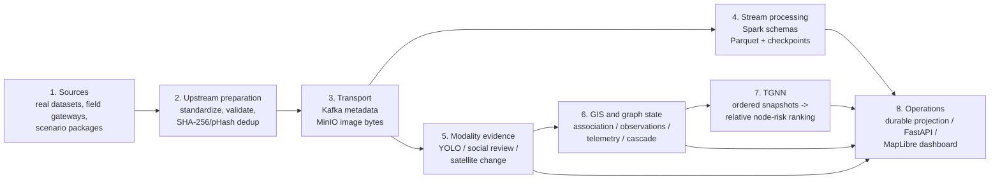

---

## 3. Data-source and producer architecture

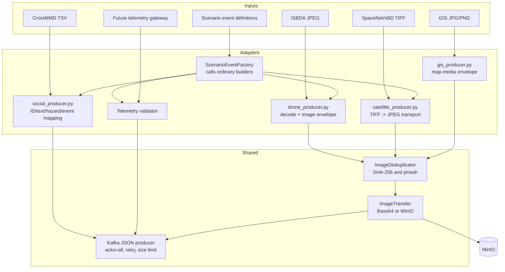

---

## 4. Scenario replay sequence

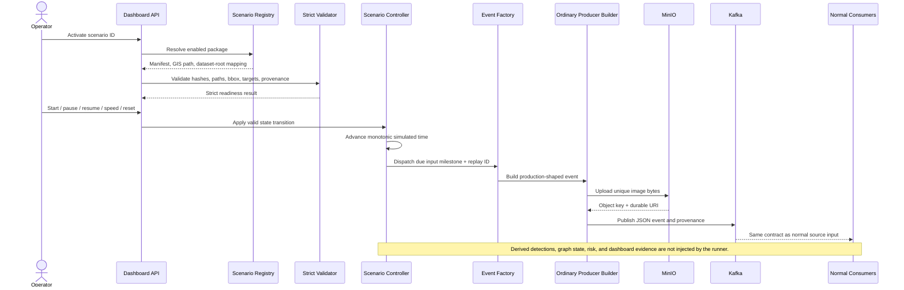

---

## 5. Kafka topic and consumer map

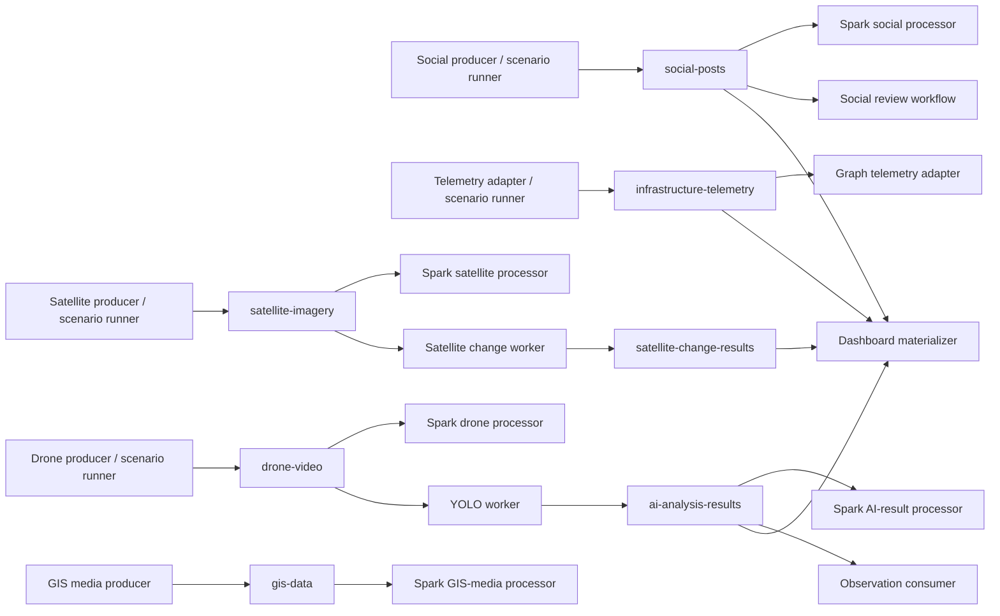

### Topic contract table

| Topic | Event meaning | Primary consumers |
| --- | --- | --- |
| `social-posts` | Standardized report plus optional scenario/GPS provenance | Spark, social workflow, dashboard state |
| `drone-video` | Unique image envelope or auditable duplicate reference | Spark, YOLO worker |
| `satellite-imagery` | JPEG transport view plus original TIFF provenance | Spark, satellite change worker |
| `gis-data` | GIS map-media image envelope | Spark and diagnostics |
| `infrastructure-telemetry` | Targeted load/capacity/damage/recovery event | Graph state and dashboard state |
| `ai-analysis-results` | Live checkpoint result or explicit filtered/error state | Spark, observation consumer, dashboard state |
| `satellite-change-results` | WGS84 broad-area change grid and summary | Dashboard only |

---

## 6. Drone image, YOLO, and GIS-association sequence

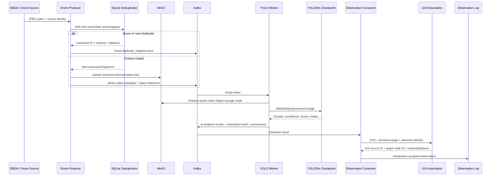

---

## 7. Satellite architecture and boundary

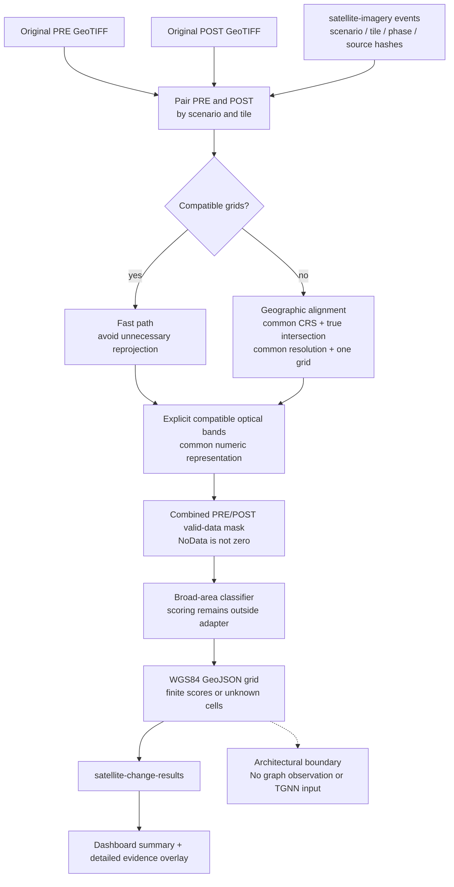

### Satellite principles represented

- Alignment uses georeferencing, never array stretching.
- Output covers only the true shared geographic footprint.
- Incompatible sensors/bands fail instead of receiving invented mappings.
- Invalid pixels become unknown or are excluded, not treated as observations.
- Change scoring stays in the classifier, not the normalization adapter.
- WGS84 GeoJSON is broad-area dashboard evidence only.

---

## 8. Social report state and review architecture

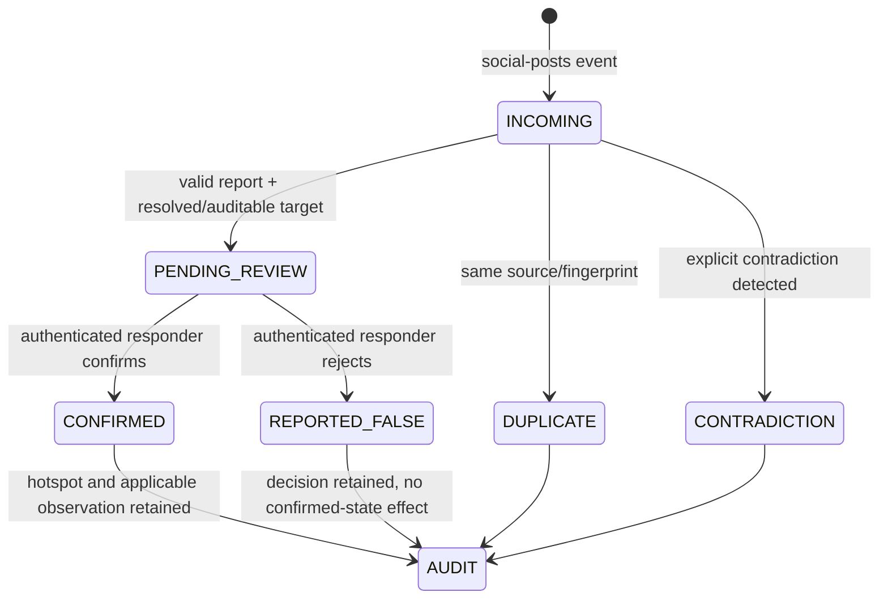

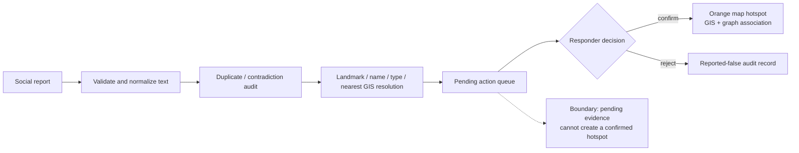

---

## 9. GIS, graph state, cascade, and TGNN architecture

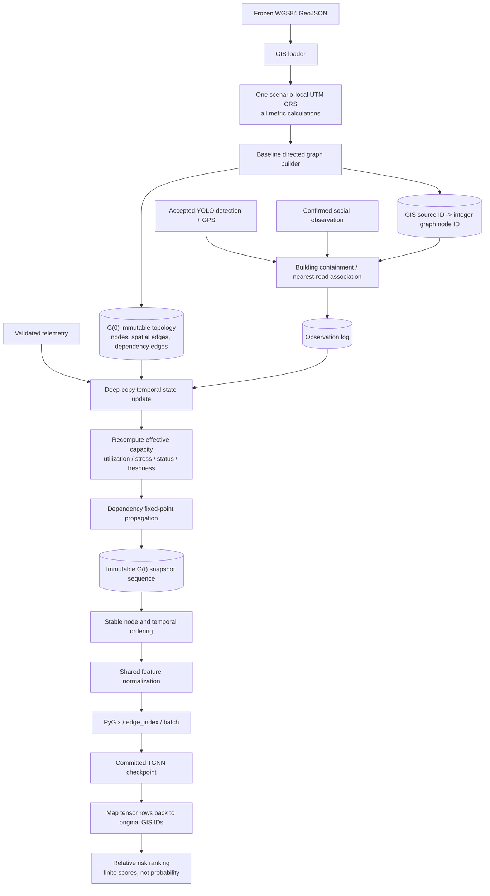

### State equations

The graph-state layer derives, for each node:

```text
intrinsic capacity = capacity * (1 - damage)^1.5
effective capacity = intrinsic capacity * dependency factor
utilization        = load / capacity
stress             = min(1, load / effective capacity)
```

Dependency propagation changes service availability/effective capacity. It
does not copy a provider's physical damage value onto a dependent node.

---

## 10. Dashboard projection and scenario isolation

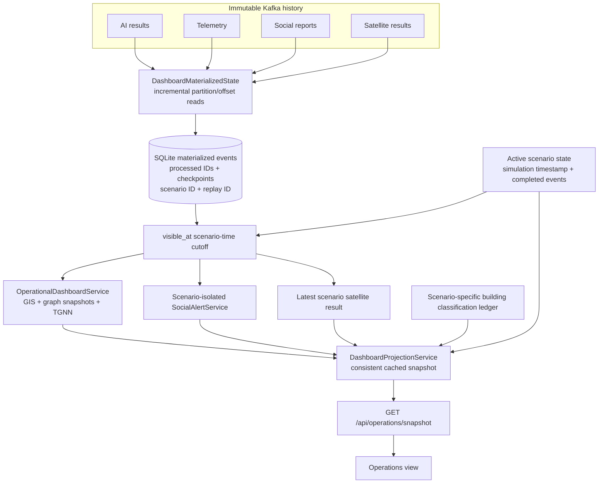

### Why this projection exists

- It does not reconstruct state from arbitrary “latest 100/200” tails.
- Kafka partition/offset checkpoints make refresh incremental and durable.
- Processed IDs make duplicate refresh idempotent.
- The scenario clock creates one internally consistent evidence cutoff.
- A cache token prevents unchanged inputs from rerunning TGNN.
- Scenario reset changes replay-visible state without deleting Kafka history.

---

## 11. Building classification architecture

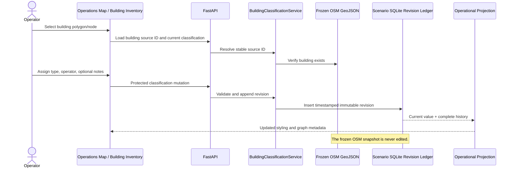

---

## 12. Dashboard navigation and user roles

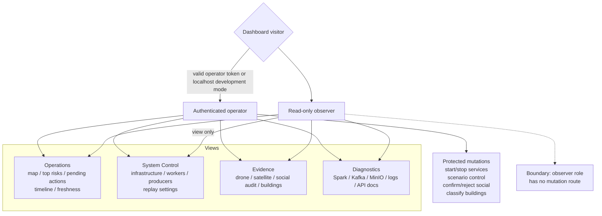

Mutation endpoints require both operator authorization and the custom
`X-Dashboard-Request` marker; cross-origin operator requests are rejected.
Detailed exceptions are logged locally while clients receive generic errors.

---

## 13. Runtime process architecture

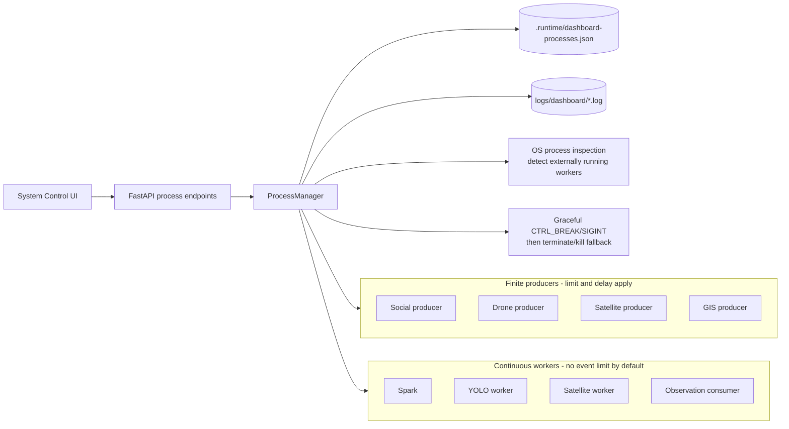

---

## 14. Physical deployment diagram

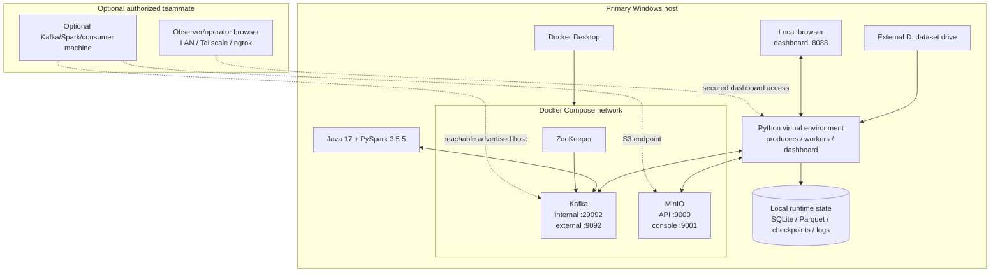

The local Compose deployment uses plaintext Kafka and development credentials.
A field deployment should replace it with authenticated TLS/SASL Kafka,
least-privilege object storage, replicated infrastructure, and managed secrets.

---

## 15. Persistent state and reset boundaries

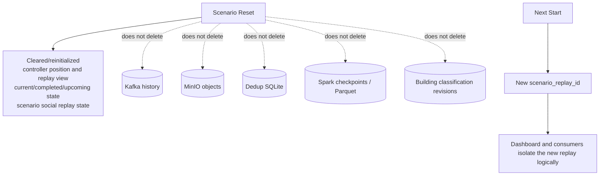

This separation preserves audit history while allowing a clean scenario
presentation.

---

## 16. Evidence semantics and allowed effects

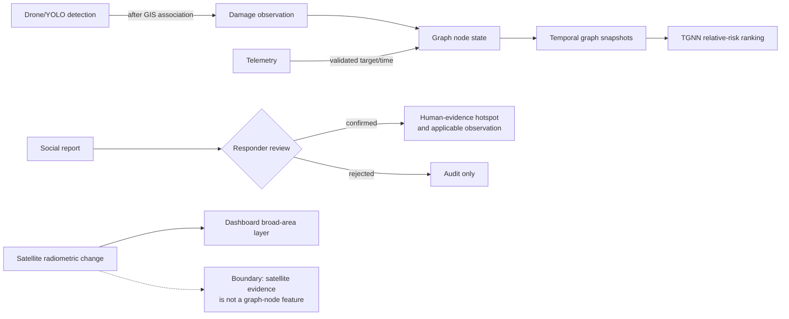

| Evidence | Can affect confirmed map state? | Can affect graph state? | Can enter TGNN? |
| --- | --- | --- | --- |
| Drone/YOLO detection | Yes, as evidence | Yes, after accepted GIS association | Indirectly through graph snapshots |
| Infrastructure telemetry | Yes | Yes | Indirectly through graph snapshots |
| Pending social report | Pending queue only | No | No |
| Confirmed social report | Yes, orange hotspot | Only through explicitly applicable observation semantics | Not a structural damage feature |
| Rejected social report | Audit only | No | No |
| Satellite change grid | Yes, broad-area overlay | No | No |
| Manual building classification | Map/metadata styling | Metadata lookup, not raw damage | Not a TGNN feature by itself |

---

## 17. Primary implementation map

| Architecture area | Main implementation |
| --- | --- |
| Configuration | `.env`, `config/settings.py` |
| Infrastructure | `docker-compose.yml`, `scripts/create_topics.py` |
| Deduplication and transfer | `common/deduplication.py`, `common/image_transfer.py`, `common/object_storage.py` |
| Producers | `data_source/*/*_producer.py` |
| Scenario registry/replay | `scenario_runtime/`, `scripts/run_scenario.py`, `scripts/validate_scenario.py` |
| Spark | `spark/spark_streaming.py`, `spark/*_processor.py` |
| YOLO | `ai/computer_vision/worker.py`, `ai/computer_vision/detector.py`, `ai/preprocessing/pipeline.py` |
| Satellite | `core/satellite/normalizer.py`, `broad_area_classifier.py`, `change_worker.py` |
| Social review | `core/nlp/`, `dashboard/social_alert_service.py` |
| GIS and graph | `core/gis/`, `core/graphs/`, `core/observation/` |
| TGNN | `core/integration/pyg_bridge.py`, `core/integration/tgnn_predictor.py`, `tgnn/` |
| Durable dashboard state | `dashboard/materialized_state.py`, `dashboard/projection_service.py` |
| Dashboard backend | `dashboard/server.py`, `dashboard/*_service.py`, `dashboard/process_manager.py` |
| Dashboard frontend | `dashboard/static/index.html`, `dashboard/static/modules/` |

---

## 18. Presentation guidance

For one architecture slide, use **Section 2**. For a technical presentation:

1. Start with the layered diagram.
2. Use the topic map to explain asynchronous interfaces.
3. Use the drone sequence to show traceability from image to graph node.
4. Use the satellite diagram to explain geographic alignment and the
   dashboard-only boundary.
5. Use the graph/TGNN diagram to explain temporal state and ranking.
6. End with the dashboard projection diagram to show how all evidence is joined
   consistently without modifying upstream history.

The master diagram is best used in documentation or as a zoomable appendix.

---

## 19. One-sentence architecture summary

> The system converts heterogeneous real and simulated disaster inputs into
> traceable Kafka/MinIO evidence, validates and persists stream metadata with
> Spark, analyzes each modality through separate evidence-specific workers,
> associates accepted observations with an immutable GIS-derived temporal
> graph, ranks evolving infrastructure risk with a committed TGNN checkpoint,
> and presents one scenario-isolated operational picture without allowing
> broad-area satellite change or unconfirmed social reports to silently mutate
> node risk.
