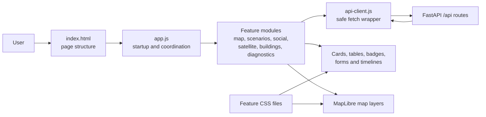
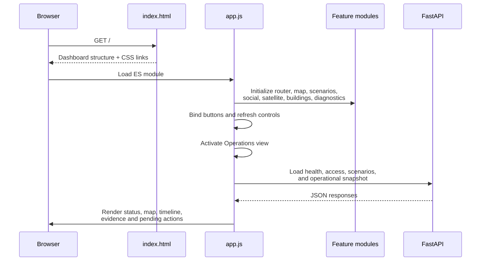
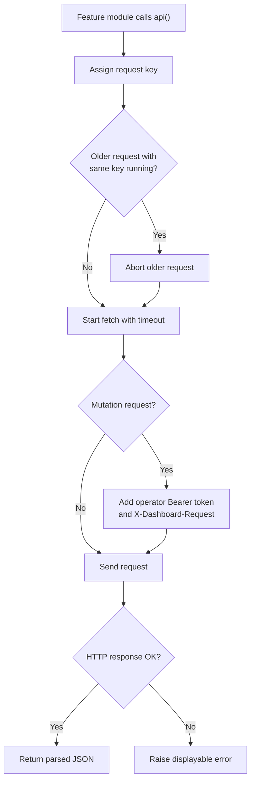
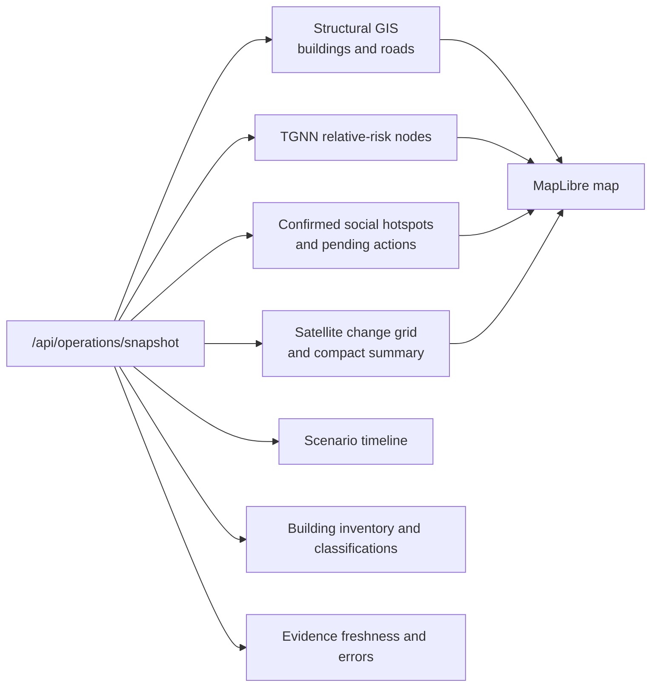
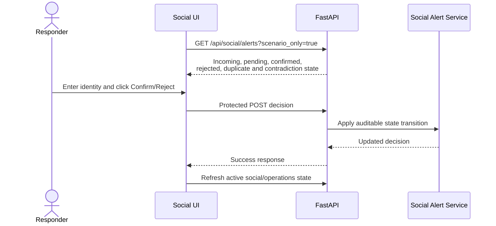

# Frontend Architecture Guide

## A simple explanation of how the DisasterScope dashboard works

This document explains only the web dashboard: what the browser loads, how a
button click becomes an API request, how results appear on screen, and which
files are responsible for each feature.

The frontend is intentionally lightweight. It does not use React, Angular, or
Vue. It uses:

- one HTML page for the dashboard structure;
- plain CSS for presentation;
- native JavaScript modules for behavior;
- the browser `fetch` API for backend communication; and
- MapLibre GL JS for the interactive operations map.

The browser does **not** read Kafka, MinIO, SQLite, model checkpoints, or GIS
files directly. FastAPI reads those systems and returns safe JSON or image
responses to the browser.

---

## 1. The frontend in one picture



In plain language:

1. The browser opens `index.html`.
2. `index.html` loads the styles, MapLibre, and `app.js`.
3. `app.js` initializes navigation and all feature modules.
4. The active view requests JSON from FastAPI.
5. A feature module converts the JSON into cards, tables, status badges, or
   GeoJSON map layers.
6. Only an authenticated operator can send commands that change system state.

---

## 2. Important frontend files

### Page shell

| File | Simple responsibility |
| --- | --- |
| `dashboard/static/index.html` | Defines the sidebar, header, views, forms, buttons, map container, loading messages, and empty/error placeholders. |
| `dashboard/static/app.js` | Starts the dashboard and coordinates navigation, refresh, authentication, process controls, and feature modules. |

### JavaScript modules

| File | What it controls |
| --- | --- |
| `modules/core.js` | Shared browser state, safe HTML utilities, time/size formatting, toast messages, and small DOM update helpers. |
| `modules/api-client.js` | All normal JSON API requests, timeouts, cancellation, operator token headers, and mutation-request protection headers. |
| `modules/router.js` | Sidebar navigation, active-view switching, page titles, and keyboard navigation. |
| `modules/operations-map.js` | The main MapLibre map, structural GIS, TGNN risk nodes, social hotspots, satellite cells, top risks, and map popups. |
| `modules/scenario-controls.js` | Scenario registry, scenario selection, validation badge, timeline, start, pause, resume, reset, and playback speed. |
| `modules/social-alerts.js` | Pending alerts, confirm/reject actions, responder identity, counts, and audit records. |
| `modules/satellite-evidence.js` | Shared satellite-data adapter, compact Operations summary, detailed PRE/POST evidence, normalization details, and change grid. |
| `modules/building-classifications.js` | Building inventory, filters, selected-building panel, classification updates, and revision history. |
| `modules/diagnostics.js` | Readiness, processes, Kafka counts, Spark rows, YOLO evidence, MinIO objects, image previews, and logs. |

### CSS and map library

| File | Styling area |
| --- | --- |
| `styles.css` | Global colors, typography, cards, forms, header, sidebar shell, common badges, and responsive basics. |
| `navigation.css` | Navigation groups, active links, refresh controls, and access-mode controls. |
| `operations.css` | Operations map, legend, risk cards, timeline, map controls, and operational panels. |
| `process-controls.css` | Producer, worker, and infrastructure control cards. |
| `ai.css` | YOLO evaluation cards, filters, thumbnails, and live inference results. |
| `satellite.css` | PRE/POST panels, satellite statistics, provenance, and detailed evidence. |
| `social.css` | Pending alerts and social audit rows. |
| `building.css` | Building inventory, classification component, and revision history. |
| `diagnostics.css` | Spark tables, MinIO browser, logs, status grids, and diagnostic contrast. |
| `vendor/maplibre-gl.js` and `.css` | Pinned MapLibre GL JS 4.7.1 assets, stored locally so the map renderer does not depend on a CDN during a demo. |

The raster OpenStreetMap background still needs network access. Project GIS
and evidence overlays can remain available even if the background tiles do not
load.

---

## 3. What happens when the page starts

The final line of `app.js` calls `bootstrap()`.



`bootstrap()` performs five main jobs:

1. It connects sidebar navigation to the router.
2. It registers the event handlers owned by each feature module.
3. It installs a refresh button inside each view.
4. It registers global controls such as login, logout, auto-refresh,
   infrastructure start/stop, and process start/stop.
5. It activates **Operations** as the first view.

The frontend behaves like a single-page application: switching views hides and
shows sections already present in `index.html`; it does not load a completely
new webpage.

---

## 4. Navigation and active views

The sidebar is organized by user intent:

- **Operations**: incident map, risk ranking, pending actions, scenario
  timeline, and freshness.
- **System Control**: readiness, infrastructure, continuous workers, finite
  producers, and replay settings.
- **Evidence**: Drone/YOLO, Satellite, Social audit, and Buildings.
- **Diagnostics**: Kafka counts, Spark output, MinIO browser, logs, and API
  documentation.

Each navigation button has a `data-view` value. `router.js` uses that value to:

1. cancel requests belonging to the previous view;
2. update `state.activeView`;
3. highlight the selected navigation button;
4. show the matching `.view` section;
5. update the visible heading and browser-tab title; and
6. ask `app.js` to refresh only the new active view.

The navigation supports `ArrowUp`, `ArrowDown`, `Home`, and `End` keys.

---

## 5. Shared browser state

`core.js` exports one small in-memory `state` object. It keeps information that
several modules need during the current browser session, such as:

- the active view;
- the MapLibre map instance;
- the latest operational snapshot;
- available buildings and the selected building;
- MinIO objects and AI results;
- refresh timers and active requests;
- the latest successful refresh time for each view; and
- the operator token for the current browser tab.

This is **not** the authoritative disaster database. Reloading the browser can
clear this memory. Durable scenario, evidence, review, and classification state
lives behind the backend APIs.

The shared helpers also make rendering safer and cheaper:

- `escapeHtml()` prevents API text from being interpreted as HTML.
- `safeUrl()` accepts only HTTP/HTTPS URLs.
- `setTextIfChanged()` avoids unnecessary text updates.
- `setHTMLIfChanged()` avoids rebuilding a section when its HTML is unchanged.
- `toast()` and `announce()` provide visible and accessible feedback.

---

## 6. How API requests work

Frontend modules normally call the `api()` function in `api-client.js` rather
than calling `fetch()` themselves.



Important behavior:

- The normal timeout is 12 seconds; specific calls can override it.
- Starting a newer request with the same key aborts the older request.
- Changing views cancels old view-specific work.
- Hiding the browser tab stops polling and cancels active requests.
- A timeout becomes a readable error instead of leaving the UI waiting forever.
- Mutation requests automatically receive the custom
  `X-Dashboard-Request: DisasterScope-Operator` header.
- If an operator token exists, it is sent as an `Authorization: Bearer` header.

---

## 7. Refresh behavior

`app.js` owns the refresh loop.

On each refresh it loads:

1. lightweight global health and access state; and
2. only the loader for the active view.

For example, while the user is viewing Satellite evidence, the browser does
not also fetch Spark rows, MinIO objects, logs, AI results, and the full
Operations view.

Users can:

- refresh the active view manually;
- enable or disable auto-refresh; and
- choose a 5, 10, 30, or 60 second interval.

If refresh fails, the last successful content stays visible and receives a
stale/error indication. This is important operationally: a temporary network
failure should not erase the last known incident picture.

The dashboard distinguishes several times:

- **UI refresh time**: when the browser last received a successful response;
- **source event time**: when the underlying evidence occurred;
- **graph snapshot time**: when graph state was updated; and
- **TGNN inference time**: when the risk ranking was calculated.

---

## 8. How the Operations page works

The Operations page makes one main request:

```text
GET /api/operations/snapshot
```

This response contains one internally consistent package:

- operational GIS and graph layers;
- current TGNN risk results;
- accepted damage observations;
- scenario state and timeline;
- scenario-specific social state;
- the latest satellite result;
- building classifications;
- evidence freshness; and
- source-specific errors.

`operations-map.js` then distributes those parts to the correct shared
renderers.



### Map layers

The MapLibre map contains these primary sources and layers:

| Map layer | Meaning | Interaction |
| --- | --- | --- |
| Structural buildings | Building polygons from scenario GIS | Click to open the building classification component when the feature has a registered building ID. |
| Structural roads | Road segments from scenario GIS | Visual structural context. |
| Risk nodes | TGNN relative-risk result for graph nodes | Click for rank, score, damage, stress, status, temporal change, and calibration warning. |
| Confirmed hotspots | Social reports confirmed by a responder | Click for report/evidence details. |
| Satellite change cells | Broad-area PRE/POST radiometric change | Click for severity and the warning that pixel change is not confirmed infrastructure damage. |

Layer checkboxes change MapLibre visibility; they do not delete evidence.

Before updating a GeoJSON source, the module compares a data signature. If the
data has not changed, it does not ask MapLibre to redraw that source.

### Important map interpretation

- Risk-node color and size represent a relative TGNN score, not failure
  probability.
- Satellite cells represent broad image change, not detected buildings.
- A pending social report does not appear as a confirmed hotspot.
- Clicking a building can open classification only when the feature maps to a
  registered building source ID.

---

## 9. Scenario selection and replay controls

`scenario-controls.js` loads the scenario registry from:

```text
GET /api/scenarios
```

The top selector shows the registered scenarios and their readiness. An
operator can activate a selected scenario through:

```text
POST /api/scenarios/{scenario_id}/activate
```

Activation causes the dashboard to refresh so the map position, GIS layers,
timeline, evidence, social state, and building state correspond to the chosen
scenario.

Start, pause, resume, reset, and speed controls call protected
`/api/scenario/...` endpoints. The frontend displays the result, but the
backend scenario controller owns the real simulation clock and state.

---

## 10. Social-alert workflow in the frontend

The same social renderer supports the compact pending list on Operations and
the detailed Social audit view.



The frontend never treats a button click as confirmation by itself. It waits
for the backend response, then reloads the authoritative state.

---

## 11. Satellite evidence in the frontend

`satellite-evidence.js` uses one adapter function to normalize the backend
response for both presentations:

- a compact summary and overlay on Operations; and
- a detailed Satellite Evidence view.

The detailed view shows:

- PRE and POST previews;
- changed, scored, unknown, and total cell counts;
- timestamp, tile, and WGS84 footprint;
- source dataset and safe provenance;
- checksums where supplied;
- reference labels;
- working/output CRS;
- normalized dimensions, selected bands, and valid coverage; and
- the explicit statement that satellite output is not a TGNN feature.

The frontend only renders the GeoJSON result received from the backend. It
does not realign rasters or calculate change scores in JavaScript.

---

## 12. Building classification in the frontend

There is one reusable classification component with two entry points:

1. click a registered building on the Operations map; or
2. select a building from the searchable Buildings inventory.

The component loads:

```text
GET /api/buildings/{building_source_id}
```

It displays source ID, graph node, current assigned type, operator, timestamp,
and revision history. An operator saves a new revision through:

```text
POST /api/buildings/{building_source_id}/classification
```

After a successful save, the module updates the current browser copy of the
building, structural layer, and risk metadata immediately. It then keeps the
backend's append-only revision ledger as the authoritative history. The frozen
OSM source is never edited.

---

## 13. System Control and Diagnostics

`diagnostics.js` renders several kinds of developer and operator information.

### Global readiness

The header and System Control view distinguish:

- infrastructure health;
- processing readiness;
- data-source readiness;
- scenario validation; and
- dashboard freshness.

States include healthy, degraded, stopped, unavailable, and unknown. The UI
does not treat “no exception occurred” as proof that every worker is ready.

### Process controls

Processing workers and producers are displayed separately:

- Spark, YOLO, satellite-change, and observation workers normally run
  continuously.
- Social, drone, satellite, and GIS producers replay finite datasets and use
  event-limit/delay controls.

Only processes owned by the dashboard can be stopped from its normal Stop
button. Externally running processes are reported separately.

### Evidence and diagnostic views

- Drone/YOLO separates held-out model metrics, training metrics, and live
  scenario inference.
- Spark shows durable Parquet rows by selected source.
- MinIO lists objects and loads a preview only when the user selects one.
- Logs load the selected process log and preserve the existing view until a
  new response succeeds.

---

## 14. Observer and operator modes

The dashboard supports two browser roles.

### Read-only observer

An observer can view:

- maps and risk ranking;
- scenario status and timeline;
- evidence and audit history;
- readiness and diagnostics; and
- building classifications.

### Authenticated operator

An operator can additionally:

- activate and control scenarios;
- start or stop infrastructure and processes;
- confirm or reject social reports; and
- create building-classification revisions.

The frontend disables mutation controls for observers, but that is only a
usability layer. FastAPI independently protects every mutation endpoint. A
user cannot bypass authorization merely by enabling a disabled HTML button.

The operator token is stored only in JavaScript memory for the current browser
tab. It is not written into Git or browser local storage by this frontend.

---

## 15. Loading, empty, stale, and error states

The dashboard intentionally treats these states differently:

- **Loading**: a first request is in progress and no previous data exists.
- **Empty**: the request succeeded, but there are no matching records.
- **Stale**: a refresh failed, but a previous successful result remains visible.
- **Error**: the requested source could not be loaded; the UI shows a readable
  message rather than silently presenting zero as real data.

This distinction prevents operational misunderstanding. “No detections” is
not the same as “the detection API could not be reached.”

---

## 16. Accessibility and demo resilience

The current frontend includes:

- semantic navigation labels;
- keyboard navigation in the sidebar;
- focusable interactive map;
- ARIA labels for refresh and map controls;
- polite/assertive live messages for actions and errors;
- escaped dynamic content;
- cancellation of outdated network work;
- locally vendored MapLibre JavaScript/CSS; and
- responsive styling for laptop, projector, and narrower layouts.

For a demo, the map renderer is available offline, but the default raster map
background may be blank without internet. The structural/evidence overlays are
project data and are not the same as the external basemap tiles.

---

## 17. End-to-end examples

### Example A: clicking a risk node

```text
User clicks risk circle
  -> MapLibre click handler reads feature properties
  -> operations-map.js formats rank, score and graph state
  -> safe popup HTML is shown
  -> if its GIS ID is also a registered building ID,
     the shared building-classification component opens
```

### Example B: confirming a social report

```text
Operator enters responder identity and clicks Confirm
  -> social-alerts.js sends a protected POST request
  -> api-client.js adds authorization and request-protection headers
  -> FastAPI validates operator permission
  -> backend records the decision
  -> frontend refreshes authoritative social/operational state
  -> confirmed hotspot appears consistently wherever relevant
```

### Example C: switching scenario

```text
Operator selects Mexico or Louisiana
  -> scenario-controls.js requests scenario activation
  -> backend changes the active scenario context
  -> frontend refreshes the operational snapshot
  -> map fits the scenario bounds
  -> GIS, risk, social, satellite, timeline and buildings are replaced together
```

### Example D: a refresh fails

```text
Active-view request times out
  -> api-client.js aborts the request
  -> app.js marks the view stale
  -> last successful data stays visible
  -> error message explains that refresh failed
  -> next auto/manual refresh can recover normally
```

---

## 18. How to add a frontend feature safely

For a new view or widget:

1. Add semantic HTML and explicit loading/empty/error placeholders to
   `index.html`.
2. Put feature behavior in the closest existing module, or create a focused
   module under `dashboard/static/modules/`.
3. Use `api()` rather than direct `fetch()` for normal JSON calls.
4. Escape API-derived text before inserting HTML.
5. Add the loader to `viewLoaders` only if it is a standalone view.
6. Refresh only the active view; do not add another global polling loop.
7. Preserve the last successful content on temporary errors.
8. Require backend authorization for every mutation; disabling a button is not
   security.
9. Add CSS to the relevant feature stylesheet instead of expanding one
   unrelated file.
10. Add dashboard tests for response contracts, interaction behavior, empty
    data, missing media, and error states.

---

## 19. Frontend-to-API reference

| Frontend concern | Main API |
| --- | --- |
| Readiness, services, processes, counts | `GET /api/status` |
| Observer/operator mode | `GET /api/access` |
| Operational map and incident snapshot | `GET /api/operations/snapshot` |
| Scenario registry | `GET /api/scenarios` |
| Activate scenario | `POST /api/scenarios/{scenario_id}/activate` |
| Scenario timeline/state | `GET /api/scenario` |
| Scenario controls | `POST /api/scenario/{action}` |
| Social state | `GET /api/social/alerts` |
| Social decision | `POST /api/social/alerts/{alert_id}/{action}` |
| Building inventory/detail | `GET /api/buildings`, `GET /api/buildings/{id}` |
| Building classification | `POST /api/buildings/{id}/classification` |
| Satellite evidence | `GET /api/satellite/change` |
| Drone/YOLO evidence | `GET /api/ai` |
| Spark output | `GET /api/spark/{source}` |
| MinIO listing/preview | `GET /api/objects`, `GET /api/object?key=...` |
| Logs | `GET /api/logs/{name}` |
| Infrastructure control | `POST /api/infrastructure/{action}` |
| Process control | `POST /api/process/{name}/start`, `POST /api/process/{name}/stop` |

---

## 20. One-sentence summary

> The frontend is a modular browser dashboard that requests scenario-isolated
> JSON from FastAPI, safely converts it into operational cards and MapLibre
> layers, refreshes only what the user is viewing, preserves the last known
> picture during failures, and exposes state-changing controls only to an
> authenticated operator.
