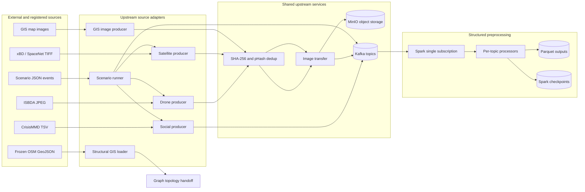
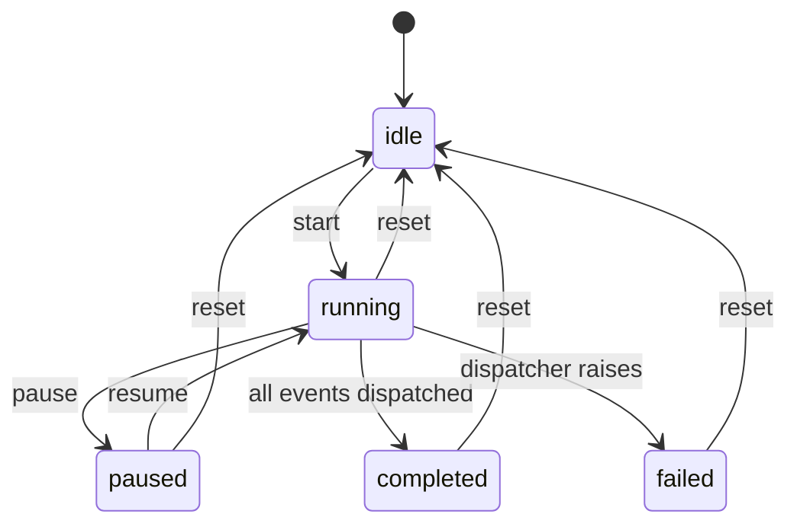

# Upstream Architecture Deep Dive

## Ingestion, provenance, transport, storage, validation, and Spark preprocessing

This document explains the part of the disaster-streaming system that exists
before model inference and temporal graph prediction. In this document,
**upstream** includes:

- configuration and dataset discovery;
- ordinary dataset producers;
- the multi-scenario registry, validation, clock, and publisher;
- image decoding and producer-side preparation;
- exact and near-duplicate detection;
- MinIO object storage;
- Kafka topics and message delivery;
- Spark Structured Streaming validation and metadata persistence;
- structural GIS loading and graph-topology preparation, stopping before TGNN
  inference; and
- infrastructure telemetry ingestion, stopping before graph-state mutation.

The following are deliberately outside the main scope:

- YOLO/RescueNet model preprocessing and inference;
- NLP interpretation and responder review logic;
- satellite change scoring and severity classification;
- temporal graph state updates and cascading failures; and
- TGNN tensor creation, inference, and risk ranking.

Those systems consume the contracts prepared by upstream. They do not define
how raw evidence enters the platform.

---

## 1. The one-minute mental model

The upstream architecture separates four responsibilities:

1. **Source adapters** understand external formats such as CrisisMMD TSV,
   ISBDA JPEG, xBD/SpaceNet TIFF, map imagery, scenario JSON, and OSM GeoJSON.
2. **Evidence storage** keeps large image bytes in MinIO while retaining stable
   checksums and object keys.
3. **Event transport** uses Kafka to carry small JSON envelopes, timing,
   provenance, and object references between independent services.
4. **Stream preprocessing** uses Spark to parse explicit schemas, reject invalid
   records, normalize selected fields, retain Kafka lineage, and write durable
   Parquet metadata.

The design principle is:

> Store large evidence once, transport small references, preserve lineage, and
> never make downstream services depend on the original dataset folder layout.

### High-level flow



### Simple presentation analogy

- **Producers are translators.** Each translator understands one source format.
- **MinIO is the evidence warehouse.** It stores the heavy files.
- **Kafka is the event highway.** It carries messages and references.
- **Spark is the intake desk.** It validates, cleans, labels, and files metadata.
- **The AI and graph layers are investigators.** They work only after intake.

---

## 2. Upstream boundaries: what enters and what leaves

### Inputs accepted by the current codebase

| Input family | Real source used now | Original form | Upstream output |
| --- | --- | --- | --- |
| Social reports | CrisisMMD or registered scenario text | TSV row / JSON definition | `social-posts` JSON event |
| Drone evidence | ISBDA | JPG/JPEG bytes | MinIO object plus `drone-video` event |
| Satellite evidence | xBD or SpaceNet 8 | TIFF/GeoTIFF | JPEG transport object plus `satellite-imagery` event and original-file provenance |
| GIS map media | Configured map imagery folder | JPG/JPEG/PNG | MinIO object plus `gis-data` event |
| Structural GIS | Frozen OSM-derived snapshot | GeoJSON in WGS84 | Reprojected `GISData`, stable source IDs, and graph topology handoff |
| Telemetry | Registered simulation today | JSON event | `infrastructure-telemetry` event |
| Scenario control | Registered scenario package | JSON manifests and timeline | Ordered production-shaped events |

### Outputs handed to downstream layers

Upstream exposes four kinds of handoff:

1. Kafka events on stable topic names.
2. MinIO object keys/URIs for image bytes.
3. Spark Parquet metadata under `storage/processed/`.
4. Structural GIS objects and ID mappings used to construct the graph baseline.

Upstream does **not** produce detections, calibrated probabilities, inferred
damage, graph risk, or responder decisions.

---

## 3. Repository map for upstream

```text
disaster-streaming-system/
|-- .env.example                     Safe configuration template
|-- docker-compose.yml               ZooKeeper, Kafka, MinIO
|-- config/
|   `-- settings.py                  Typed environment-backed settings
|-- common/
|   |-- topics.py                    Canonical topic names
|   |-- kafka_utils.py               JSON Kafka producer and send helper
|   |-- object_storage.py            S3/MinIO client
|   |-- image_transfer.py            Base64 vs object-reference envelope
|   `-- deduplication.py             SHA-256/pHash SQLite registry
|-- data_source/
|   |-- social/social_producer.py    CrisisMMD adapter
|   |-- drone/drone_producer.py      ISBDA adapter
|   |-- satellite/satellite_producer.py
|   `-- gis/gis_producer.py          GIS image-media adapter
|-- scenario_runtime/
|   |-- registry.py                  Registered scenario catalogue
|   |-- controller.py                Simulation clock and state machine
|   `-- publisher.py                 Scenario-to-production contract adapter
|-- scenarios/
|   |-- registry.json
|   |-- louisiana_east_flood/
|   `-- mexico_earthquake_2017/
|-- spark/
|   |-- spark_streaming.py           One Kafka source, topic fan-out, sinks
|   |-- social_processor.py
|   |-- drone_processor.py
|   |-- satellite_processor.py
|   |-- gis_processor.py
|   `-- ai_processor.py              Downstream-result intake, outside core upstream
|-- core/gis/
|   `-- gis_loader.py                WGS84 -> local projected CRS
|-- core/graphs/
|   `-- gis_graph_builder.py         Structural topology handoff
|-- consumer/
|   `-- interactive_consumer.py      Transport inspection and image reconstruction
|-- scripts/
|   |-- create_topics.py
|   |-- validate_scenario.py
|   |-- fetch_osm_scenario_gis.py
|   |-- run_scenario.py
|   |-- run_spark.ps1 / run_spark.sh
|   `-- test_kafka.py / test_object_storage.py
`-- storage/
    |-- dedup/                        Generated SQLite fingerprint database
    |-- processed/                    Generated Spark Parquet output
    |-- checkpoints/                  Generated Spark offset/query state
    `-- received_images/              Optional interactive-consumer downloads
```

---

## 4. Configuration layer

### 4.1 `.env.example`

`.env.example` is the safe, version-controlled catalogue of runtime settings.
The real `.env` is local and must not be committed because it can contain:

- MinIO credentials;
- an operator token;
- removable-drive paths;
- host-specific Kafka addresses; and
- machine-specific runtime choices.

Important setting groups are:

| Group | Representative variables | Effect |
| --- | --- | --- |
| Kafka | `KAFKA_BOOTSTRAP_SERVERS`, `KAFKA_ADVERTISED_HOST`, `KAFKA_MAX_MESSAGE_BYTES` | Client address, remote reachability, event ceiling |
| Datasets | `SOCIAL_DATASET_PATH`, `DRONE_DATASET_PATH`, `SATELLITE_DATASET_PATH`, `GIS_DATASET_PATH` | Ordinary producer roots |
| Scenario datasets | `SPACENET8_DATASET_PATH`, `XBD_DATASET_PATH`, `ISBDA_DATASET_PATH`, `CRISISMMD_DATASET_PATH` | Roots used to resolve registered external files |
| Replay timing | `SOCIAL_STREAM_DELAY`, `DRONE_STREAM_DELAY`, `SATELLITE_STREAM_DELAY`, `GIS_STREAM_DELAY` | Delay between ordinary producer events |
| Image transfer | `IMAGE_TRANSFER_MODE`, `OBJECT_STORAGE_*` | Base64 or MinIO/S3 transport |
| Deduplication | `IMAGE_DEDUPLICATION_ENABLED`, `NEAR_DUPLICATE_*`, `PHASH_*`, `DEDUP_DATABASE_PATH` | Exact/near-duplicate policy |
| Spark | `SPARK_MASTER`, `SPARK_STARTING_OFFSETS`, `DISASTER_KEYWORDS` | Execution and preprocessing behavior |
| Scenario selection | `FINAL_SCENARIO_PATH`, `MAP_SCENARIO_GEOJSON` | Default scenario/structural snapshot |

The example currently defaults `IMAGE_TRANSFER_MODE` to `base64` for simple
local setup. For the intended architecture, `object_storage` is preferred.

### 4.2 `config/settings.py`

This file is the single Python configuration boundary. At import time it:

1. resolves the repository root;
2. loads `.env` with `python-dotenv`;
3. converts numeric and Boolean values safely;
4. creates an immutable `Settings` dataclass instance; and
5. exposes resolved paths and logging helpers.

Its `_int`, `_float`, and `_bool` helpers prevent every module from inventing
its own environment parsing. Invalid numeric strings fall back to documented
defaults and produce a warning.

`require_directory()` is important at the ingestion boundary. It fails with a
clear message when a configured dataset path is empty, missing, or on a
disconnected removable drive. This prevents a producer from appearing to run
successfully while reading nothing.

`configure_logging(component)` writes both to the console and to
`logs/<component>.log`. This gives every independent upstream process its own
evidence trail.

### 4.3 Why configuration is not hard-coded

Raw datasets are intentionally excluded from Git. A teammate can mount the
same logical datasets at a different path and only change `.env`. The event
contracts, hashes, scenario manifests, and source-relative paths remain stable.

---

## 5. Local infrastructure

### 5.1 `docker-compose.yml`

The Compose file starts three services:

| Service | Port | Purpose |
| --- | --- | --- |
| ZooKeeper | internal `2181` | Coordination required by this Kafka deployment |
| Kafka | host `9092`, internal `29092` | Ordered event transport |
| MinIO | API `9000`, console `9001` | S3-compatible image storage |

Kafka has separate listeners:

- `EXTERNAL` advertises `${KAFKA_ADVERTISED_HOST}:9092` to host or remote
  clients; and
- `INTERNAL` advertises `kafka:29092` inside Docker.

This distinction explains a common networking failure: a remote client may
reach the bootstrap address but then fail if Kafka advertises `localhost`.
`localhost` on the teammate's computer means the teammate's computer, not the
Kafka host.

Kafka automatic topic creation is disabled. This is intentional: misspelled
topic names must not silently create a second stream.

The development deployment uses:

- one broker;
- replication factor 1;
- three partitions per application topic; and
- plaintext listeners.

It is appropriate for a capstone demo, not a production emergency network.

MinIO stores data in the named Docker volume `minio-data`. `docker compose
stop` preserves it; deleting the volume does not.

### 5.2 Health checks

- ZooKeeper checks that `srvr` reports a mode.
- Kafka lists topics against its internal listener.
- MinIO calls its live health endpoint.

Container `running` and service `healthy` are different states. The producers
should start only after Kafka and MinIO are healthy.

### 5.3 `scripts/create_topics.py`

This script reads the canonical list from `common/topics.py`, compares it with
the broker's existing topics, and creates only missing topics. Therefore it is
idempotent and safe to rerun.

Each created topic has three partitions and replication factor one. Ordering is
guaranteed only **within one partition**, not globally across all partitions.

### 5.4 Connectivity verification

- `scripts/test_kafka.py` verifies broker access and required topic presence
  without modifying event data.
- `scripts/test_object_storage.py` uploads, presigns, downloads, and byte-checks
  a small object.
- `scripts/configure_windows.ps1` helps configure reachable Kafka and MinIO
  addresses for one-system, LAN, or Tailscale operation.

---

## 6. Kafka event backbone

### 6.1 Canonical topics

`common/topics.py` defines all names in one place:

| Topic | Primary producer | Upstream meaning |
| --- | --- | --- |
| `social-posts` | Social producer / scenario runner | Raw standardized social report |
| `drone-video` | Drone producer / scenario runner | Drone image envelope or duplicate record |
| `satellite-imagery` | Satellite producer / scenario runner | Satellite transport image and provenance |
| `gis-data` | GIS image producer | Map-image envelope |
| `infrastructure-telemetry` | Scenario runner / future sensor gateway | Timestamped target measurements |
| `ai-analysis-results` | YOLO worker | Downstream AI output; Spark can archive it, but it is not an upstream source |
| `satellite-change-results` | Satellite change worker | Downstream broad-area result; not part of Spark's current subscription |

### 6.2 `common/kafka_utils.py`

`create_json_producer()` creates a producer with:

- JSON UTF-8 serialization;
- `acks="all"`;
- five retries;
- the configured request-size limit;
- a 30-second request timeout; and
- a bounded API-version discovery timeout.

In this one-broker development stack, `acks="all"` means the one in-sync broker
acknowledges the record. It does not create multi-broker durability.

`send_event()` waits synchronously for Kafka metadata and logs the assigned
partition and offset. It returns `False` instead of terminating a long-running
producer when one send fails.

The producer does not enable Kafka transactions or an idempotent producer
contract explicitly. The architecture therefore must not be presented as
globally exactly-once. Deduplication and consumer offset handling provide
practical replay safety, but they are not a formal end-to-end exactly-once
guarantee.

### 6.3 Kafka lineage

When Spark reads a record, it retains:

- topic;
- partition;
- offset; and
- Kafka timestamp.

This tuple identifies the exact transport record. It is different from the
source event timestamp and scenario timestamp.

---

## 7. Image transport and MinIO

### 7.1 Why images are separated from messages

Images can be megabytes; event metadata is usually kilobytes. Sending every
image through Kafka increases network traffic, broker disk usage, consumer
memory, serialization cost, and Spark parsing load.

The intended object-storage flow is:

```text
source image bytes
  -> SHA-256
  -> upload once to MinIO
  -> Kafka JSON contains object_key, image_uri, checksum, and metadata
  -> consumers download only when they need pixels
```

### 7.2 `common/object_storage.py`

`ObjectStorageClient` wraps the S3 API through `boto3`. It works with MinIO or
another S3-compatible service because endpoint, region, bucket, and credentials
come from configuration.

Initialization requires credentials and calls `_ensure_bucket()`:

1. try `head_bucket`;
2. if the bucket is absent or inaccessible in a way that might be recoverable,
   try to create it; and
3. raise `ObjectStorageError` if access/creation fails.

`upload()` performs `put_object`, sets the content type, and returns:

- bucket;
- object key;
- durable `s3://bucket/key` URI; and
- temporary presigned HTTP download URL.

`download()` retrieves bytes by authenticated object key. This is more durable
than depending on a presigned URL after it expires.

### 7.3 `common/image_transfer.py`

`ImageTransfer` gives every image producer the same envelope regardless of
transport mode.

Common fields added in either mode are:

- `transfer_mode`;
- `size_bytes`;
- `content_hash`; and
- `is_duplicate=false`.

#### Base64 mode

The bytes become ASCII text in `image_data`. Base64 is easy for a first local
demo because one Kafka record is self-contained. Its disadvantages are:

- roughly 33% size expansion before JSON overhead;
- repeated byte copies during encoding/decoding;
- large Kafka records;
- large Spark input rows; and
- inability to fetch pixels independently of the event.

#### Object-storage mode

The object key is:

```text
<source>/<first-two-hash-characters>/<sha256>_<safe-filename>
```

For example:

```text
drone/9a/9af3...c821_6_270.jpg
```

The checksum-derived path distributes objects across prefixes and makes the
content lineage visible. `Path(filename).name` strips directory components so
a source filename cannot perform path traversal.

Kafka receives `object_key`, `image_uri`, and `download_url`, not another copy
of the pixels.

### 7.4 Important URL distinction

- `image_uri` is a stable logical S3 URI.
- `object_key` is the durable retrieval identity inside the configured bucket.
- `download_url` is temporary and should not be treated as permanent evidence.

Spark intentionally persists the durable key/URI rather than an expiring URL.

---

## 8. Image deduplication in depth

### 8.1 File: `common/deduplication.py`

The deduplicator answers two different questions:

1. **Are these bytes exactly the same?** Use SHA-256.
2. **Does this image look almost the same after resize/recompression?** Use
   perceptual hash and Hamming distance.

### 8.2 Exact duplicate path

`content_hash(data)` calculates SHA-256 over the exact transported bytes.

If two byte sequences differ by one bit, their SHA-256 values should differ
dramatically. SHA-256 therefore detects retransmission of the same file, but
not a visually identical JPEG saved with a different quality.

The SQLite table makes `content_hash` unique. An exact match returns:

- `is_duplicate=true`;
- original canonical image ID;
- current and canonical content hashes;
- `duplicate_method="sha256"`; and
- distance `0`.

### 8.3 Perceptual duplicate path

The pHash implementation:

1. converts color images to grayscale;
2. resizes to `32 x 32` using area interpolation;
3. applies a Discrete Cosine Transform;
4. takes the low-frequency `8 x 8` block;
5. compares coefficients against their median; and
6. packs the comparison bits into a hexadecimal fingerprint.

Low-frequency structure captures broad appearance and ignores many small pixel
changes. Two pHashes are compared with bitwise XOR; the number of different
bits is the Hamming distance.

The most recent configured number of candidates for the same source is
searched. If the best distance is at or below `PHASH_DISTANCE_THRESHOLD`, the
image is considered a near duplicate.

### 8.4 Why pHash defaults to drone only

`NEAR_DUPLICATE_SOURCES=drone` is a safety decision:

- consecutive drone frames may repeat almost the same view; but
- a subtle difference between pre-event and post-event satellite images may be
  the actual disaster signal.

Using near-duplicate suppression on satellite imagery could discard meaningful
change. Exact SHA-256 deduplication still applies to all sources.

### 8.5 Persistent and concurrent behavior

Fingerprints are stored in
`storage/dedup/image_fingerprints.sqlite3`. The database survives producer
restart. WAL mode, a 30-second busy timeout, a process-level lock, and `BEGIN
IMMEDIATE` protect the check-and-register sequence from common concurrent
writer races.

The stored fields are:

- source;
- canonical ID;
- SHA-256 content hash;
- optional perceptual hash; and
- creation time.

### 8.6 Duplicate events are still published

A duplicate is not silently erased. `duplicate_event_fields()` emits a small
Kafka record containing canonical lineage and
`processing_status="duplicate_skipped"`. This makes the retry/repetition
auditable without storing or processing the pixels again.

### 8.7 Rollback on failure

The producer registers a unique image before transfer/send so concurrent
attempts see it. If MinIO upload, payload validation, or Kafka delivery fails,
`unregister_canonical()` removes that uncommitted fingerprint. Otherwise the
failed first attempt could cause every retry to be incorrectly treated as an
already delivered duplicate.

An upload may have already written an object before Kafka fails. A retry uses
the same checksum-derived key, so it overwrites/reuses that logical object
rather than generating a new random object name.

---

## 9. Ordinary dataset producers

All four ordinary producers follow this lifecycle:

```text
validate dataset root
  -> discover supported files/rows
  -> build standardized event
  -> enforce Kafka message-size limit
  -> publish synchronously
  -> delay to simulate a stream
  -> flush and close on completion or Ctrl+C
```

`--limit` makes dataset producers finite for demos. `--delay` controls replay
speed. These controls do not belong on continuous consumers such as Spark or
the AI workers.

### 9.1 Social producer

**File:** `data_source/social/social_producer.py`

**Source:** recursively discovered CrisisMMD `.tsv` files.

`csv.DictReader(..., delimiter="\t")` reads each row. `standardize_record()`
supports common alternative column names:

- ID: `tweet_id` or `id`;
- text: `tweet_text` or `text`;
- hazard: `label`, `label_text`, or `informative`; and
- event: `event_name` or `event`.

Rows without both a non-empty ID and text are skipped. A valid base event is:

```json
{
  "id": "source post identifier",
  "text": "original report text",
  "hazard": "dataset label or unknown",
  "event": "dataset event name or unknown",
  "timestamp": 0.0,
  "source": "twitter",
  "data_type": "text"
}
```

The timestamp is `time.time()` when the ordinary producer replays the row. It
is ingestion/replay time, not necessarily the post's original social-media
creation time.

No MinIO path is needed because text events are small.

### 9.2 Drone producer

**File:** `data_source/drone/drone_producer.py`

**Source:** recursively discovered JPG/JPEG files, currently ISBDA for the
registered scenarios.

For each image:

1. read the original bytes;
2. decode with OpenCV;
3. calculate SHA-256 and, for drone, pHash;
4. query/register the persistent deduplication index;
5. construct the base metadata;
6. attach Base64 or upload to MinIO;
7. serialize once to estimate final Kafka record size;
8. publish to `drone-video`; and
9. unregister a new canonical fingerprint if delivery fails.

Base metadata fields are:

```json
{
  "frame_id": "6_270.jpg",
  "timestamp": 0.0,
  "source": "drone",
  "data_type": "image",
  "format": "jpg"
}
```

OpenCV decoding is used both to reject unusable input and to create the pHash.
It is not the YOLO preprocessing stage.

### 9.3 Satellite producer

**File:** `data_source/satellite/satellite_producer.py`

**Source:** recursively discovered `.tif`/`.tiff` files.

The ordinary satellite transport path converts TIFF pixels into JPEG:

1. OpenCV decodes the TIFF unchanged.
2. Non-8-bit values are min-max normalized to `0..255`.
3. Grayscale is converted to BGR.
4. Four-channel BGRA is converted to BGR.
5. JPEG is encoded using `SATELLITE_JPEG_QUALITY`.
6. Deduplication operates on the transported JPEG bytes and decoded image.

The event distinguishes:

- `original_format`: `tif` or `tiff`; and
- `stream_format`: `jpg`.

This JPEG is a transport/display representation. It is not a reconstructed
GeoTIFF and must not be claimed to retain the original raster transform, CRS,
NoData mask, or scientific pixel precision.

For registered scenarios, original path, SHA-256, bounding box, tile, and phase
are added separately. The original TIFF remains the authoritative geospatial
source for the universal normalizer/change-analysis branch.

### 9.4 GIS image producer

**File:** `data_source/gis/gis_producer.py`

This producer reads JPG/JPEG/PNG **map images**, decodes and deduplicates them,
and publishes `gis-data` events. It demonstrates generic map-media ingestion.

It must not be confused with structural GIS. A screenshot of a map cannot
replace vector roads, building polygons, stable source IDs, or topology.

The base identifier is `map_id`, and the content type follows PNG versus JPEG.

---

## 10. Frozen scenario packages

### 10.1 Why a scenario package exists

An ordinary producer walks an entire dataset and uses wall-clock replay time.
A presentation needs a short, repeatable disaster story with selected evidence,
known ordering, target associations, expected effects, and honest provenance.

A scenario package freezes those choices without inventing final AI results.

### 10.2 `scenarios/registry.json`

The registry currently contains:

- `louisiana-east-flood-v1`; and
- `mexico-earthquake-2017-v1`.

Each registration includes:

- scenario ID and title;
- package path;
- map center and WGS84 bounding box;
- required datasets;
- environment variables used as dataset roots; and
- enabled state.

Louisiana remains the default.

### 10.3 `scenario_runtime/registry.py`

`ScenarioRegistry` loads the catalogue, resolves package paths relative to the
repository, and verifies that registry and manifest IDs agree. It rejects
duplicate registrations, an unknown default, unknown IDs, and disabled
scenarios.

The immutable `ScenarioRegistration` exposes standard paths for:

- `scenario.json`; and
- `gis/infrastructure.geojson`.

This removes Louisiana-specific paths from services and lets scenario-aware
components select data by scenario ID.

### 10.4 Package contents

A package contains some or all of:

```text
scenario.json                 Asset/provenance manifest and short event list
timeline.json                 Full ordered story and expected effects
satellite/pair.json           PRE/POST source paths, hashes, footprints
drone/selection.json          Selected real images plus assigned context
drone_events.json             Scenario drone arrival definitions
social/source.json            Registered source dataset evidence
social_events.json            Simulated/selected report definitions
telemetry.json                Simulated sensor/state events
responder_decisions.json      Expected review choices
gis/infrastructure.geojson    Frozen structural snapshot
expected_results.json         Acceptance statements, not invented model output
```

Images themselves remain on the external dataset drive. Git stores paths,
hashes, and provenance, not the raw dataset.

### 10.5 Real versus simulated provenance

The scenario makes provenance additive. A real ISBDA image can carry a
simulated Louisiana or Mexico GPS position. The image remains real; its assigned
position is explicitly simulated.

Common scenario fields are:

- `scenario_id`;
- `scenario_event_id`;
- `scenario_replay_id`;
- `scenario_timestamp`;
- `input_origin`; and
- `simulation_fields`.

`simulation_fields` is the key honesty mechanism. It states exactly which
parts, such as GPS, timestamp, target association, telemetry, or report text,
are simulated.

---

## 11. Strict scenario validation

### File: `scripts/validate_scenario.py`

Strict validation runs before replay. It checks both internal consistency and,
when external roots are provided, the actual mounted files.

Major validation groups include:

### Identity and geography

- scenario ID exists;
- WGS84 bbox contains four finite ordered coordinates;
- center lies inside the bbox;
- GIS metadata bbox matches the scenario bbox;
- satellite PRE and POST footprints align with the scenario bbox; and
- assigned drone coordinates lie inside the scenario bbox.

### Asset integrity

- asset IDs are present and unique;
- status and input-origin values are recognized;
- dataset, original path, SHA-256, footprint, and time are present;
- committed package files match their registered hashes;
- external SpaceNet/xBD, ISBDA, and CrisisMMD files match checksums when mounted;
  and
- strict mode rejects pending assets.

### Provenance honesty

- `simulation_fields` is a list;
- real ISBDA imagery is identified as real imagery;
- assigned GPS, scenario time, and target context are declared simulated where
  required; and
- source contracts do not present transferred context as measured reality.

### Referential integrity

- timeline sources reference registered assets;
- drone events reference selected drone assets;
- target GIS IDs exist in the frozen snapshot;
- event IDs are unique; and
- scenario/package IDs agree.

### Temporal contract

- offsets are non-negative, unique, and strictly increasing;
- every detailed timeline event has an input, timestamp, target, expected graph
  effect, and expected dashboard effect; and
- scenario start and timeline start agree.

Passing strict validation means the package is internally traceable and its
mounted evidence matches registered checksums. It does not prove that simulated
GPS or telemetry occurred in the real disaster.

---

## 12. Scenario clock and control state machine

### File: `scenario_runtime/controller.py`

`ScenarioController` is independent of Kafka and datasets. It knows only:

- an ordered list of events with `offset_seconds`;
- an absolute scenario start time;
- a dispatcher callback; and
- playback speed.

### State machine



Invalid transitions raise `InvalidRunnerTransition`; for example, pause from
idle or start twice.

### Two clocks, two meanings

The controller deliberately uses two clock concepts:

1. `time.monotonic()` measures elapsed playback time. It is immune to wall-clock
   adjustments and is multiplied by playback speed.
2. `scenario_start + elapsed` produces the displayed simulation timestamp.

At `10x`, ten simulated seconds pass for one real second. Pause materializes
the elapsed position; resume creates a new monotonic anchor.

### Reset and replay identity

Each start creates a random `scenario_replay_id`. Reset:

- increments an internal generation token;
- invalidates the old worker loop;
- returns position to zero;
- clears current/completed events; and
- clears the replay ID.

Reset does not delete Kafka history, MinIO objects, or Spark checkpoints. The
replay ID distinguishes repeated runs in the immutable event history.

### Dispatch discipline

The controller publishes only events whose offsets are due. It deep-copies
definitions so a consumer cannot mutate the frozen timeline. If dispatch fails,
the state becomes `failed` with the error; the event is not silently marked
complete.

---

## 13. Scenario event construction and publication

### File: `scenario_runtime/publisher.py`

`ScenarioEventFactory` converts registered assets into the same schemas used by
ordinary producers.

This is the most important anti-demo-shortcut rule:

> The scenario runner publishes inputs through real producer/Kafka contracts.
> It does not insert detections, graph states, TGNN risks, or final dashboard
> results.

### Drone scenario event

1. Find event definition by ID.
2. Resolve selected asset and external ISBDA path.
3. Call the ordinary drone producer's `build_event()`.
4. Add scenario provenance, timestamp, GPS, asset ID, target ID, and reference
   class.
5. Publish to `drone-video`.

Special replay rule: if the same real image is already in the dedup database,
the runner preserves duplicate evidence but reattaches canonical bytes and sets
`process_duplicate_for_scenario_replay=true`. This permits a real checkpoint to
run for a new scenario context instead of inventing detections or silently
dropping the replay.

### Satellite scenario event

1. Resolve PRE and POST registered TIFFs.
2. Call the ordinary satellite builder for the JPEG transport representation.
3. Add phase, tile, bbox, source path, source SHA-256, source size, dataset, and
   reference annotation counts.
4. Publish both events to `satellite-imagery`.

Duplicate PRE/POST transport images can also be reattached for replay while
remaining marked as duplicate-derived reuse.

### Social scenario event

The factory calls `standardize_record()` from the ordinary social producer,
then adds:

- scenario provenance;
- frozen scenario epoch timestamp;
- GPS;
- target IDs; and
- `review_status="PENDING_REVIEW"`.

The event remains pending input. The runner does not confirm it.

### Telemetry scenario event

Telemetry includes:

- event ID;
- scenario epoch timestamp;
- target ID;
- load;
- capacity;
- damage;
- event type;
- source/data type; and
- scenario provenance.

`validate_telemetry_event()` checks the event before Kafka publication. The
downstream graph state logic, not the scenario runner, decides how a valid
measurement changes state.

### Dispatcher routing

`ScenarioKafkaDispatcher.ROUTES` maps selected timeline milestone names to
topic and factory method. Milestones representing derived outcomes have no
route and log that downstream services must derive them.

For each payload the dispatcher:

1. adds the replay ID;
2. calculates serialized UTF-8 size;
3. rejects events at or above Kafka's configured maximum;
4. sends through the standard Kafka helper;
5. rolls back new image registration on failure; and
6. flushes/closes the producer at shutdown.

---

## 14. Timestamp architecture

Several timestamps coexist because they answer different questions:

| Timestamp | Meaning | Created by |
| --- | --- | --- |
| `timestamp` | Source/replay event time as Unix seconds | Producer or scenario factory |
| `scenario_timestamp` | Human-readable time inside the frozen story | Scenario package/factory |
| `kafka_timestamp` | Time Kafka recorded the message | Kafka broker/source connector |
| `received_at` / `event_timestamp` | Parsed source timestamp | Spark processor |
| `processed_at` | Time Spark handled the row | Spark processor |
| monotonic controller time | Stable elapsed playback duration | Scenario controller, not published directly |

For ordinary dataset replay, `timestamp=time.time()` represents when the file
was replayed. For a frozen scenario, the factory replaces it with the epoch of
the registered scenario timestamp.

Missing or out-of-order time should never be repaired by silently substituting
the current time in downstream state logic. Upstream preserves the source value
so later validation can reject or quarantine stale input.

---

## 15. Structural GIS upstream path

### 15.1 GIS has two distinct meanings in this repository

1. `gis-data` contains streamed map **images** for the generic media pipeline.
2. `gis/infrastructure.geojson` contains vector features used for spatial
   lookup and graph topology.

Only the second can answer questions such as “which exact building or road is
this observation near?”

### 15.2 `scripts/fetch_osm_scenario_gis.py`

This utility queries OpenStreetMap through Overpass for a specified bbox. It
separates geometry-heavy roads/buildings from infrastructure queries to reduce
public endpoint timeout cost.

The output is a GeoJSON FeatureCollection with:

- OSM type and ID;
- project `feature_class`;
- source attribution and ODbL license;
- retrieval time;
- WGS84 bbox and CRS; and
- counts by feature class.

The resulting snapshot is committed/frozen for repeatability. Runtime manual
classification does not edit it.

### 15.3 `core/gis/gis_loader.py`

The loader expects WGS84/CRS84 longitude-latitude input. It accepts:

- `infrastructure` points;
- `road_segment` lines; and
- `building` polygons.

It also recognizes selected native conventions such as `highway` and
`building=yes`.

Infrastructure with missing/unsupported `node_type` is excluded and counted;
the loader does not invent a type.

### 15.4 Why projection is required

Longitude and latitude are angular coordinates. Measuring “400 meters” by
subtracting degrees is geographically wrong and location-dependent.

The loader:

1. calculates the accepted feature extent;
2. chooses one local UTM zone from the bbox midpoint, including Norway/Svalbard
   exceptions;
3. rejects invalid WGS84, out-of-UTM-range, or antimeridian-spanning data; and
4. reprojects every geometry into that one metric working CRS.

The selected CRS travels inside `GISData`. Spatial calculations use projected
meters. WGS84 conversion happens only at output/map boundaries.

### 15.5 `core/graphs/gis_graph_builder.py` as the upstream handoff

This file constructs the immutable baseline topology consumed later by graph
state and TGNN components:

- infrastructure points become nodes directly;
- road segments become midpoint nodes;
- buildings become provisional `social` nodes because their infrastructure
  function is not verified;
- spatial edges connect nodes within a disclosed radius; and
- dependency edges connect dependents to nearby providers by configured type.

It also returns `id_map`:

```text
GIS source ID -> integer graph node ID
```

This mapping is critical because Kafka observations carry stable GIS IDs while
PyG/TGNN later require stable integer row order.

Baseline load, capacity, and stress values are disclosed modeling defaults,
not measured field telemetry. This document stops at topology preparation; the
later state-update and TGNN behavior is outside upstream.

---

## 16. Spark Structured Streaming architecture

### 16.1 Launcher files

- `scripts/run_spark.ps1` locates Java 17, the project virtual environment, and
  the Windows Hadoop helper before running `spark-submit`.
- `scripts/run_spark.sh` runs the equivalent Unix command.
- Both request `spark-sql-kafka-0-10_2.12:3.5.5`, matching PySpark 3.5.5.

On Windows, Java and Hadoop helper setup is runtime infrastructure. It does not
change stream semantics.

### 16.2 `spark/spark_streaming.py`

The service creates one Spark session named `DisasterStructuredStreaming`, uses
the configured master, and reduces shuffle partitions to four for the local
demo scale.

It creates **one Kafka streaming source** subscribed to:

- `social-posts`;
- `drone-video`;
- `satellite-imagery`;
- `gis-data`; and
- `ai-analysis-results`.

The raw source selects only:

- Kafka value cast to string as `value_text`;
- topic;
- partition;
- offset; and
- Kafka timestamp.

The combined stream is filtered by topic and sent to a dedicated processor.
This is more efficient and consistent than starting a separate Kafka consumer
for every dashboard widget.

`failOnDataLoss=false` favors continued demo operation if Kafka retention or
partition changes make an offset unavailable. The tradeoff is that Spark may
continue after a data gap instead of failing hard; production audit systems may
prefer stricter handling.

### 16.3 Starting offsets and checkpoints

`SPARK_STARTING_OFFSETS` matters only when no compatible checkpoint exists:

- `latest`: consume records arriving after the first start;
- `earliest`: intentionally process retained history.

Once `storage/checkpoints/<stream>/` exists, checkpointed progress takes
precedence. Restarting Spark with the same checkpoint resumes rather than
reapplying the environment setting from scratch.

Deleting checkpoints is therefore a semantic reset, not routine cleanup.

### 16.4 Sinks

Each processed stream has:

- an append-mode Parquet sink at `storage/processed/<name>/`;
- an independent checkpoint at `storage/checkpoints/<name>/`; and
- a console sink for live diagnostics.

Social grouped counts use complete output mode because the aggregate table is
updated over time.

Parquet is columnar, typed, compressed, and efficient for dashboard previews or
offline evaluation. It stores metadata, not a second copy of Base64 images.

### 16.5 Graceful shutdown

On Ctrl+C, the service stops every streaming query and then the Spark session.
This is preferable to killing the JVM because query/checkpoint state can close
cleanly.

---

## 17. Per-topic Spark preprocessing

Spark processing here is schema- and rule-based, not AI.

### 17.1 Social: `spark/social_processor.py`

The explicit schema accepts the seven base social fields. Processing:

1. parses JSON;
2. requires ID and non-empty text;
3. lowercases text;
4. collapses whitespace and trims it;
5. creates a regex from configured disaster keywords;
6. adds Boolean `keyword_match`;
7. converts Unix time to `event_timestamp`;
8. adds current `processed_at`; and
9. selects Kafka lineage fields.

`analytics()` groups by event and hazard and counts rows. This is descriptive
counting, not NLP classification, credibility assessment, or confirmation.

Important limitation: the schema currently does not include scenario GPS,
target IDs, review status, or scenario provenance. Those fields remain in the
Kafka event for scenario-aware consumers but are dropped from the social
Parquet projection.

### 17.2 Drone: `spark/drone_processor.py`

Validation requires:

- non-null `frame_id`;
- `source="drone"`;
- `format` in JPG/JPEG; and
- either duplicate status, Base64 data, or an image URI.

Output status is:

- `duplicate_skipped` for duplicates; or
- `ready_for_ai` for accepted unique frames.

The output retains IDs, transport mode, durable URI/key, checksums, size,
duplicate lineage, event/processing time, and Kafka lineage.

The Base64 column is deliberately omitted from `.select(...)`, so it does not
enter Parquet.

Important limitation: scenario GPS, target, asset, replay ID, and provenance
are not part of this Spark schema. They remain available to the direct
`drone-video` consumer but are not all present in drone Parquet.

### 17.3 Satellite: `spark/satellite_processor.py`

Validation requires:

- non-null image ID;
- `source="satellite"`;
- original TIFF/TIFF format;
- JPEG stream format; and
- duplicate status, Base64 data, or image URI.

It marks `duplicate_skipped` or `ready_for_ai`, converts times, removes Base64,
and preserves durable image/dedup/Kafka metadata.

Important limitation: phase, tile, bbox, source file hash/path, reference
annotation counts, and other scenario fields are not selected into satellite
Parquet. The satellite change consumer reads the original Kafka contract.

### 17.4 GIS image media: `spark/gis_processor.py`

The processor parses `map_id`, source, format, transport references, hash,
size, duplicate status, and canonical ID. It requires a map ID and
`source="gis"`, adds timestamps, and marks either `duplicate_skipped` or
`ready`.

This is still map-image metadata, not vector-feature parsing.

### 17.5 AI results: `spark/ai_processor.py`

The Spark service also archives `ai-analysis-results`. This processor is not
part of upstream under the definition used in this document because its input
already comes from YOLO. It is included in `spark_streaming.py` so one Spark
service can persist both pre-AI intake metadata and post-AI result metadata.

For a presentation focused strictly on upstream, stop the main explanation at
`ready_for_ai`. Mention AI-result Parquet only as a return/archive branch.

---

## 18. Streams that intentionally bypass Spark

Not every valid event is processed by Spark today.

### Infrastructure telemetry

`infrastructure-telemetry` is consumed by the observation/graph-state path.
Spark does not subscribe to it. This avoids falsely implying that Spark is the
central decision engine.

### Satellite change results

`satellite-change-results` goes to the dashboard broad-area evidence path. It
does not enter Spark, graph observations, or TGNN.

### Structural GeoJSON

The frozen GIS snapshot is loaded directly from the scenario package. Passing
it through the GIS image topic would destroy its vector semantics and stable
feature-ID contract.

### Scenario control state

Start, pause, resume, speed, reset, current event, and completed/upcoming event
lists are controller state. Only evidence events go to Kafka.

---

## 19. Optional transport inspection

### File: `consumer/interactive_consumer.py`

This consumer is a debugging/learning tool, not part of graph mutation. It lets
an operator select topics and:

- print social events;
- decode Base64 images;
- download MinIO images by presigned URL;
- fall back to authenticated S3 download when a URL is missing/expired;
- write reconstructed images under `storage/received_images/`; and
- print AI result JSON for inspection.

It sanitizes filenames with `Path(name).name`, validates Base64, and refuses
unsupported transfer modes. Duplicate image events are reported but not
downloaded again.

This tool is useful evidence that Kafka references can reconstruct the source
object independently of the producer.

---

## 20. Failure behavior and data-quality policy

### Source/dataset failures

- Empty/missing dataset path: producer exits with a clear configuration error.
- No supported files: producer exits rather than pretending success.
- Invalid social row: row is skipped and logged.
- Unreadable image: image is skipped and logged.
- Disconnected external drive: strict scenario validation or producer startup
  fails; the system must not fabricate a pass.

### Dedup/transfer failures

- Missing MinIO credentials: object-storage client fails explicitly.
- Upload failure: no Kafka event is presented as successfully stored.
- Oversized serialized event: event is skipped/rejected before Kafka send.
- Failed unique-image delivery: fingerprint registration is rolled back.
- Duplicate: small canonical-reference event remains auditable.

### Kafka failures

- Broker unavailable at producer creation: beginner-readable connection error.
- One send failure: logged; long dataset replay can continue.
- Topic typo: auto-creation is disabled, preventing accidental parallel topics.

### Spark failures and malformed data

- Explicit `from_json` schemas prevent arbitrary fields/types from becoming
  trusted columns.
- Filtered invalid records currently disappear from processed Parquet; there is
  no dedicated dead-letter topic in the Spark layer.
- Checkpoints preserve query progress, but deleting them can replay or skip
  data depending on `startingOffsets`.
- `failOnDataLoss=false` favors availability over strict gap detection.

### Scenario failures

- Invalid manifests fail before replay.
- Dispatcher error moves controller to `failed`.
- Reset cancels the previous generation logically but does not erase already
  published immutable history.

---

## 21. Idempotency, ordering, and replay semantics

These terms should be used carefully in a presentation.

### Idempotency mechanisms present

- SHA-256 unique constraint prevents repeated exact image registration.
- pHash suppresses configured near duplicates.
- checksum-derived MinIO keys reuse the same logical path.
- duplicate events point to canonical evidence.
- Spark checkpoints remember consumed offsets.
- scenario replay IDs distinguish separate runs.

### Guarantees not present

- No multi-broker Kafka replication in local Compose.
- No formal end-to-end transaction spanning SQLite, MinIO, Kafka, and Spark.
- No global ordering across Kafka partitions.
- No Spark dead-letter stream for rejected JSON.
- No claim that scenario-assigned locations are field-measured.

### Safe wording

Say:

> “The system is replay-aware and duplicate-resistant, with persistent image
> fingerprints and checkpointed stream progress.”

Do not say:

> “The complete system is exactly-once under every failure.”

---

## 22. Storage layout and ownership

| Location | Owner | Contents | Commit to Git? |
| --- | --- | --- | --- |
| External dataset drive | Dataset provider/user | Raw CrisisMMD, ISBDA, xBD, SpaceNet | No |
| `scenarios/...` | Repository | Manifests, hashes, selected paths, GIS snapshot | Yes |
| MinIO `disaster-images` | Object-storage layer | Canonical image bytes | No |
| Kafka topics | Broker | Ordered event log | No |
| `storage/dedup/*.sqlite3` | Producer dedup layer | Persistent fingerprints | No |
| `storage/processed/<stream>/` | Spark | Parquet metadata | No |
| `storage/checkpoints/<stream>/` | Spark | Offsets and query metadata | No |
| `storage/received_images/` | Interactive consumer | Reconstructed/downloaded copies | No |
| `logs/` | Runtime processes | Operational evidence | No |

The repository commits provenance and reproducible definitions, not generated
runtime state or licensed raw datasets.

---

## 23. End-to-end upstream walkthroughs

### 23.1 One ordinary drone image

```text
ISBDA file
  -> drone producer reads bytes
  -> OpenCV decode
  -> SHA-256 + pHash
  -> SQLite exact/near-duplicate decision
  -> MinIO upload if unique
  -> drone-video JSON with object key and lineage
  -> Spark parses drone schema
  -> validates ID/source/format/reference
  -> marks ready_for_ai or duplicate_skipped
  -> writes metadata Parquet + checkpoint
  -> downstream YOLO boundary
```

### 23.2 One scenario drone event

```text
timeline offset becomes due
  -> controller adds replay ID
  -> factory resolves registered ISBDA path
  -> ordinary drone build_event()
  -> provenance + simulated GPS/time/target attached
  -> Kafka size check
  -> drone-video
  -> Spark metadata path and YOLO direct-consumer path
```

### 23.3 One social report

```text
CrisisMMD TSV row or scenario definition
  -> standardize ID/text/hazard/event/source
  -> social-posts
  -> Spark explicit schema
  -> reject missing ID/text
  -> lowercase + collapse whitespace
  -> keyword flag
  -> Parquet + checkpoint
  -> downstream NLP/review boundary
```

### 23.4 One satellite PRE/POST pair

```text
registered original TIFF files
  -> strict path/hash/footprint validation
  -> JPEG transport representation
  -> exact dedup + MinIO
  -> two satellite-imagery events with phase/tile/bbox/source provenance
  -> Spark validates transport metadata and writes Parquet
  -> separate downstream change worker uses original geospatial provenance
```

### 23.5 Structural GIS

```text
OSM bbox query
  -> frozen WGS84 GeoJSON
  -> strict bbox and ID validation
  -> GIS loader selects local UTM CRS
  -> reprojects points/lines/polygons into meters
  -> graph builder creates nodes, topology, and GIS-ID mapping
  -> downstream temporal graph/TGNN boundary
```

---

## 24. File-by-file explanation

### Root and configuration

| File | Detailed responsibility |
| --- | --- |
| `.env.example` | Documents all host, dataset, transfer, dedup, Spark, scenario, and model settings without storing real secrets. |
| `.gitignore` | Keeps `.env`, raw datasets, logs, SQLite state, MinIO/Spark outputs, caches, and generated artifacts out of Git. |
| `docker-compose.yml` | Defines local coordination, broker, object storage, health checks, listeners, ports, and persistent MinIO volume. |
| `requirements.txt` | Pins ingestion/storage/Spark/GIS/raster/dashboard dependencies for CPython 3.10. |
| `config/settings.py` | Converts environment text to shared typed values, resolves repository-relative paths, validates dataset folders, and configures per-component logs. |

### Shared ingestion modules

| File | Detailed responsibility |
| --- | --- |
| `common/topics.py` | Prevents topic-name drift by defining all seven canonical names. |
| `common/kafka_utils.py` | Constructs JSON producers with bounded requests, acknowledgements, retries, and synchronous delivery metadata. |
| `common/object_storage.py` | Ensures the S3 bucket, uploads with content type, returns stable and temporary references, and downloads by key. |
| `common/image_transfer.py` | Adds a transport-independent event envelope and selects Base64 or content-addressed MinIO storage. |
| `common/deduplication.py` | Implements persistent SHA-256/pHash decisions, concurrency control, canonical lineage, and rollback support. |

### Producers

| File | Detailed responsibility |
| --- | --- |
| `data_source/social/social_producer.py` | Recursively reads CrisisMMD TSV, maps alternative columns, rejects incomplete rows, and streams standardized text events. |
| `data_source/drone/drone_producer.py` | Reads/decodes JPG, deduplicates, transfers pixels, checks final message size, and publishes drone envelopes. |
| `data_source/satellite/satellite_producer.py` | Reads TIFF, creates 8-bit JPEG transport images, deduplicates exact content, and preserves original-versus-stream format. |
| `data_source/gis/gis_producer.py` | Streams map media through the common image contract; it does not construct the structural graph. |

### Scenario runtime

| File | Detailed responsibility |
| --- | --- |
| `scenarios/registry.json` | Declares enabled packages, default scenario, geography, required datasets, and root environment variables. |
| `scenario_runtime/registry.py` | Resolves and validates catalogue entries and exposes scenario-scoped paths. |
| `scenario_runtime/controller.py` | Implements thread-safe state transitions, monotonic simulated time, speed, pause/resume/reset, generations, and replay IDs. |
| `scenario_runtime/publisher.py` | Resolves frozen external assets, calls ordinary producer builders, adds honest provenance, validates telemetry, and routes only input milestones to Kafka. |
| `scripts/run_scenario.py` | Performs strict validation, constructs factory/dispatcher/controller, and provides automatic or interactive playback. |
| `scripts/validate_scenario.py` | Enforces hash, geography, provenance, timing, target-ID, and external-data consistency. |

### GIS preparation

| File | Detailed responsibility |
| --- | --- |
| `scripts/fetch_osm_scenario_gis.py` | Converts Overpass OSM responses into an attributed, frozen WGS84 GeoJSON snapshot. |
| `core/gis/gis_loader.py` | Parses accepted vector feature classes, selects a scenario-local UTM CRS, and reprojects geometry into meters. |
| `core/graphs/gis_graph_builder.py` | Converts GIS elements into stable graph nodes/edges and returns the GIS-ID-to-node-ID handoff. |

### Spark

| File | Detailed responsibility |
| --- | --- |
| `spark/spark_streaming.py` | Creates one Kafka stream, fans out by topic, starts topic processors, Parquet sinks, console sinks, and independent checkpoints. |
| `spark/social_processor.py` | Parses base social schema, validates ID/text, normalizes text, flags configured keywords, and produces simple grouped counts. |
| `spark/drone_processor.py` | Validates image envelope/canonical duplicates, removes Base64 from output, and marks AI readiness. |
| `spark/satellite_processor.py` | Validates original/stream formats and transport references, then persists compact metadata. |
| `spark/gis_processor.py` | Validates GIS image-media envelopes and marks ready/duplicate state. |
| `spark/ai_processor.py` | Archives downstream YOLO output; present in the Spark service but beyond this document's upstream boundary. |
| `scripts/run_spark.ps1` | Prepares Java 17, PySpark Python, Hadoop helper, PATH, and Kafka connector on Windows. |
| `scripts/run_spark.sh` | Unix Spark launcher with the matching Kafka connector. |

### Diagnostics and controls

| File | Detailed responsibility |
| --- | --- |
| `consumer/interactive_consumer.py` | Independently verifies event decoding and image reconstruction from Base64 or MinIO. |
| `dashboard/process_manager.py` | Starts producers/workers, separates finite producers from continuous workers, records PIDs/logs/exit state, and sends graceful stop signals. |
| `scripts/test_kafka.py` | Read-only broker/topic readiness test. |
| `scripts/test_object_storage.py` | Round-trip MinIO/S3 byte-integrity test. |
| `scripts/dedup_report.py` | Reports producer fingerprint state for diagnostics. |

---

## 25. What to show in a presentation

### Recommended 8-slide upstream section

#### Slide 1: Definition and goal

“Upstream converts heterogeneous disaster sources into traceable, validated,
replayable event contracts before AI.”

#### Slide 2: Data sources

Show CrisisMMD, ISBDA, xBD/SpaceNet, OSM, telemetry, and scenario definitions.
Label real versus simulated fields.

#### Slide 3: Producer preprocessing

Show modality-specific adapters and emphasize that OpenCV decode/dedup is input
preparation, not model inference.

#### Slide 4: SHA-256 and pHash

Explain exact versus visual duplicate, canonical image, SQLite persistence, and
why pHash is drone-only by default.

#### Slide 5: Kafka plus MinIO

Use the “event highway plus evidence warehouse” analogy. Show object key and
small Kafka JSON.

#### Slide 6: Scenario runner

Show registry -> strict validation -> simulation clock -> ordinary producer
contract. Emphasize no direct dashboard injection.

#### Slide 7: Spark

Show one Kafka subscription, topic fan-out, explicit schemas, metadata-only
Parquet, and checkpoints.

#### Slide 8: Honest boundary

Show `ready_for_ai`, pending social input, original geospatial satellite
evidence, telemetry, and structural graph handoffs. State clearly that upstream
does not claim detection or risk.

---

## 26. Common viva/presentation questions

### “Why Kafka if all services run on one laptop?”

Kafka decouples arrival from processing. A producer does not need to know
whether Spark, YOLO, or another authorized consumer is on the same machine,
temporarily offline, or restarted. It also provides partition/offset lineage.

### “Why MinIO instead of putting the image in Kafka?”

Images are large immutable evidence; Kafka is optimized for event flow. MinIO
avoids Base64 overhead and lets different consumers retrieve pixels only when
needed.

### “Is Spark the AI?”

No. Current upstream Spark logic is explicit schema parsing, filtering, string
normalization, keyword matching, status labeling, and Parquet persistence.

### “Why both SHA-256 and pHash?”

SHA-256 detects identical bytes. pHash detects visually similar drone frames
whose bytes changed through resizing or JPEG recompression.

### “Could pHash remove disaster change?”

Yes if applied carelessly. That is why near-duplicate pHash is restricted to
configured sources and defaults to drone, not satellite.

### “Are the Louisiana and Mexico coordinates real?”

The scenario geography and structural snapshots describe their selected map
areas. Some source images are real dataset images, but assigned scenario GPS,
time, targets, telemetry, and reports can be simulated and are explicitly
listed in `simulation_fields`.

### “Does reset erase the event history?”

No. It resets controller/replay state and issues a new replay ID on the next
start. Kafka history, MinIO objects, and Spark checkpoints remain unless an
operator deliberately removes them.

### “Does Spark retain every scenario field?”

No. Current base schemas persist core metadata and Kafka lineage. Several
scenario-specific fields remain in Kafka for direct consumers but are not
selected into the upstream Parquet projections. This is a documented extension
point, not hidden behavior.

### “Is the system exactly-once?”

Not as a complete distributed transaction. It combines persistent dedup,
content-addressed keys, canonical duplicate events, and Spark checkpoints to be
replay-aware and duplicate-resistant.

### “Why is structural GIS not sent through Spark?”

The frozen vector snapshot is baseline configuration with stable geometry and
IDs, not a stream of map screenshots. It is loaded directly and reprojected for
metric spatial calculations.

---

## 27. Current limitations and improvement points

1. The development Kafka stack is plaintext, single-broker, and replication
   factor one.
2. Base64 remains the configuration default even though object storage is the
   preferred architecture.
3. Spark has no dead-letter topic for rejected/malformed events.
4. Spark's base schemas omit several scenario provenance fields from Parquet.
5. Ordinary social replay timestamps ingestion time, not necessarily original
   tweet creation time.
6. TIFF-to-JPEG transport loses scientific/geospatial raster properties; the
   original TIFF must remain authoritative for change analysis.
7. Producer, MinIO, Kafka, and Spark operations are not one atomic transaction.
8. Three Kafka partitions improve concurrency but remove global cross-partition
   ordering.
9. Structural graph capacity/load defaults are disclosed assumptions until
   authoritative infrastructure data replaces them.
10. Current scenario telemetry is simulated; a field deployment needs a sensor
    gateway that emits the same validated contract.

### Field-deployment replacements that preserve the architecture

| Demo component | Field replacement | Contract retained |
| --- | --- | --- |
| Folder-scanning producer | Drone SDK, satellite API, approved social API | Kafka event fields and provenance |
| Local MinIO | Managed S3/object store | Object key, checksum, durable URI |
| Local Kafka | TLS/SASL managed Kafka cluster | Topics, partitions, offsets |
| JSON schemas in code | Versioned schema registry | Typed event contract |
| Local Spark | Managed/clustered stream processing | Normalized records and checkpoints |
| Simulated telemetry | Authenticated sensor gateway | Target, timestamp, load/capacity/damage |
| Frozen local GIS | Versioned PostGIS/authoritative GIS export | Stable IDs, CRS, geometries |

---

## 28. Final summary

The upstream subsystem is not merely “reading files.” It establishes the trust
boundary for everything that follows:

- source adapters convert heterogeneous datasets into stable contracts;
- strict scenario validation keeps real and simulated claims separate;
- SHA-256 and pHash prevent redundant image work while preserving audit events;
- MinIO stores canonical heavy evidence;
- Kafka transports ordered, traceable event envelopes;
- Spark validates and persists compact metadata with offset lineage; and
- GIS preparation converts frozen WGS84 vectors into stable metric topology.

Because the scenario runner uses the same producer and Kafka boundaries as
ordinary replay, downstream consumers receive production-shaped inputs. This
is what makes the demo architecturally meaningful: the presentation controls
the timing and selected evidence, but it does not bypass ingestion or invent
the outputs of YOLO, satellite analysis, graph state, or TGNN.
