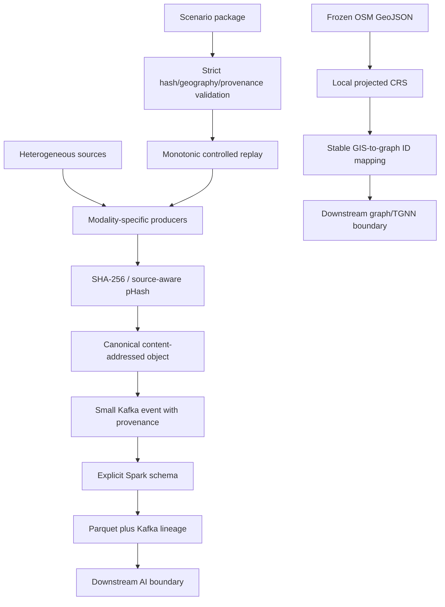

# Upstream Design Decisions and Rationale

## Why the upstream architecture is built this way

This document explains the reasoning behind the upstream architecture of the
disaster-streaming system. It complements
`UPSTREAM_ARCHITECTURE_DEEP_DIVE.md`, which explains what each component does.

Here, **upstream** means everything that prepares, validates, stores, and
transports disaster evidence before YOLO, NLP inference, satellite change
scoring, graph-state prediction, and TGNN inference.

The purpose is to answer presentation and viva questions such as:

- Why perform deduplication?
- Why use both SHA-256 and pHash?
- Why store images in MinIO instead of Kafka?
- Why use Kafka at all?
- Why is Spark rule-based?
- Why preserve topic, partition, and offset?
- Why use a scenario runner instead of inserting demo results?
- Why freeze OSM data?
- Why reproject coordinates before spatial calculations?
- Why keep simulated fields explicit?

---

## 1. Decision framework

The upstream architecture was designed around six requirements.

### 1. Traceability

Every derived result should be traceable to an original source record, image,
object key, checksum, Kafka record, scenario event, and geographic target.

### 2. Separation of responsibilities

Source readers, image storage, message transport, stream validation, AI, graph
state, and presentation should not be one tightly coupled program.

### 3. Efficient handling of large evidence

Images should not be copied through every layer when most layers need only
metadata and references.

### 4. Repeatable demonstrations

The same scenario should be replayable with controlled timing without
inventing detections or directly modifying dashboard state.

### 5. Honest provenance

Real imagery with simulated GPS, timestamps, or target assignments must never
be presented as fully field-observed evidence.

### 6. Replaceable development infrastructure

Local Kafka, MinIO, Spark, and folder-based producers should be replaceable by
managed services and field gateways without redesigning downstream contracts.

---

## 2. Decision summary matrix

| Decision | Primary reason | Risk it prevents | Main trade-off |
| --- | --- | --- | --- |
| Separate producer for each modality | Source formats have different semantics | One fragile parser making false assumptions | More modules to maintain |
| Kafka event backbone | Decouple arrival from processing | Producers depending on every consumer being online | Operational complexity |
| Topic per event family | Clear contracts and independent consumers | Mixed schemas and accidental cross-processing | More topic administration |
| MinIO for image bytes | Keep large data outside Kafka | Oversized messages and repeated byte copies | Two systems must remain available |
| Base64 as fallback | Simple one-record local testing | Setup blocking first-time users | Roughly 33% payload expansion |
| SHA-256 exact deduplication | Detect byte-identical retransmissions | Repeated storage and inference | Hashing cost and local state |
| pHash for drone near-duplicates | Detect visually repeated frames | Reprocessing recompressed/resized copies | Possible false matches |
| pHash disabled for satellite by default | Preserve subtle PRE/POST change | Disaster evidence being suppressed | More satellite duplicates may pass |
| Persistent SQLite fingerprint ledger | Dedup across restarts | Restart forgetting prior evidence | Single-host database |
| Duplicate events remain auditable | Preserve event lineage | Silent disappearance of retransmissions | Additional small Kafka records |
| Content-addressed MinIO keys | Stable identity and natural reuse | Random duplicate objects | Filename is less human-friendly |
| Explicit Kafka size check | Fail before broker rejection | Unclear late delivery failures | Oversized evidence is skipped/rejected |
| TIFF-to-JPEG transport copy | Efficient display and streaming | Huge/unsupported browser payloads | JPEG loses geospatial/scientific metadata |
| Original TIFF remains authoritative | Preserve CRS/transform/NoData | Treating JPEG as a geospatial raster | Must maintain source provenance |
| Explicit Spark schemas | Trust only known fields/types | Schema drift silently corrupting output | New fields require code changes |
| One Spark Kafka source then topic fan-out | Consistent, efficient intake | Multiple redundant consumers and snapshots | One service manages several queries |
| Parquet output | Compact typed analytics storage | Repeated Kafka scanning for diagnostics | Generated files need lifecycle management |
| Spark checkpoints | Resume stream progress | Reprocessing or losing position on restart | Reset semantics become more complex |
| Preserve Kafka lineage | Audit exact transport record | Inability to locate/replay a bad event | Extra metadata columns |
| Scenario registry and packages | Multi-scenario repeatability | Hard-coded Louisiana behavior | Package maintenance and validation |
| Strict checksums and validation | Prove registered evidence identity | Quietly using the wrong file/tile | External drive must be available |
| Same contracts for replay and field input | Test real interfaces | Demo-only path hiding integration defects | Scenario adapter is more complex |
| Monotonic simulation clock | Stable playback and speed control | OS clock changes altering event order | Separate displayed scenario time needed |
| Replay ID per run | Distinguish repeated demonstrations | Mixing two runs of identical event IDs | Consumers must retain the field |
| Reset does not delete Kafka | Preserve immutable audit history | Destructive “clean slate” behavior | Consumers need scenario/replay isolation |
| Explicit `simulation_fields` | Honest real/simulated disclosure | Misrepresenting assigned context as measured | More provenance metadata |
| Frozen OSM snapshot | Stable geometry and source IDs | Live map changes breaking repeatability | Snapshot becomes stale over time |
| Local projected CRS | Correct distance calculations in meters | Measuring geographic degrees as meters | CRS selection/transform complexity |
| Stable GIS ID to graph ID mapping | End-to-end association | Detections updating the wrong node | Mapping must remain deterministic |
| Structural GIS bypasses GIS-image topic | Preserve vector semantics | Treating screenshots as topology | Two GIS concepts must be explained |
| Finite producers, continuous workers | Match lifecycle semantics | Consumers stopping after demo event limits | Different control options in UI |
| Environment-backed configuration | Portability and secret separation | Hard-coded machine paths and credentials | Configuration can be mis-set |
| Raw datasets excluded from Git | Licensing, size, and reproducibility | Huge repository and unauthorized redistribution | Users must mount datasets separately |

---

## 3. Why separate producers are used

### Problem

The platform receives structurally different inputs:

- tab-separated social records;
- JPEG drone images;
- TIFF satellite images;
- GIS map media;
- vector GeoJSON; and
- telemetry JSON.

A single generic “read any disaster file” process would need many branches and
would be tempted to treat unlike data as interchangeable.

### Decision

Use a modality-specific producer for each source family while sharing common
Kafka, deduplication, and storage helpers.

### Why this decision was taken

Each producer can enforce source-specific facts:

- social rows need an ID and non-empty text;
- drone images must decode as JPG/JPEG;
- satellite inputs originate as TIFF but use JPEG for transport;
- GIS map media can be PNG or JPEG; and
- telemetry needs numeric state fields and a valid target.

Common infrastructure remains reusable, but semantic rules stay close to the
source that understands them.

### Alternative considered: one universal producer

This would reduce the number of entry points but create a large conditional
parser. A change to satellite handling could accidentally affect drone or GIS
behavior. Tests and error messages would become less specific.

### Trade-off

There are more small modules, but each module has a narrow responsibility and
can be replaced by a real field adapter independently.

### Presentation sentence

> “We share transport mechanisms, but we do not pretend that text, drone
> frames, satellite rasters, and GIS vectors have the same preparation rules.”

---

## 4. Why Kafka is used

### Problem

Data sources and downstream processors run at different speeds and may start,
stop, or fail independently. A drone producer should not need direct knowledge
of Spark, YOLO, the dashboard, or a graph consumer.

### Decision

Publish standardized events to Kafka topics and let independent consumer groups
read the same retained event history.

### Why this decision was taken

Kafka provides:

- temporal decoupling between producers and consumers;
- retained event history;
- per-partition ordering;
- independent consumer groups;
- explicit topic, partition, offset, and timestamp lineage; and
- the ability to place consumers on another machine.

For example, Spark and YOLO can both consume `drone-video` without the drone
producer sending two different requests.

### Alternative considered: direct REST calls

The producer could call the AI or dashboard directly. This is simpler for one
demo request, but creates strong coupling:

- the consumer must be online at arrival time;
- slow inference blocks ingestion;
- retry behavior becomes source-specific;
- adding a second consumer changes the producer; and
- event replay/audit requires another storage mechanism.

### Alternative considered: shared files only

Consumers could poll a folder. This gives weak event ordering, poor remote
operation, no consumer offsets, and unclear handling of partially written
files.

### Trade-offs

Kafka adds broker setup, topic management, networking, and offset semantics.
The current single-broker plaintext deployment is a development architecture,
not a resilient production cluster.

### What happens without Kafka?

The system becomes a sequence of tightly coupled scripts. A failure in one
layer can block the source, and the scenario runner could no longer prove that
it uses the same asynchronous interface as a field source.

---

## 5. Why separate Kafka topics are used

### Problem

Every modality has a different event schema, validation rule, volume, consumer,
and retention need.

### Decision

Use named topics such as `social-posts`, `drone-video`,
`satellite-imagery`, `gis-data`, and `infrastructure-telemetry`.

### Why this decision was taken

Separate topics provide:

- clear schema ownership;
- targeted consumer subscriptions;
- independent scaling and retention in a future deployment;
- reduced risk of a consumer interpreting the wrong event type; and
- readable operational diagnostics.

### Alternative considered: one `disaster-events` topic

A single topic would require a type discriminator and a large union schema in
every consumer. A malformed discriminator could route an image envelope into a
telemetry processor. High-volume image events could also dominate small
high-priority telemetry events.

### Trade-off

More topics require explicit creation and monitoring. The project centralizes
their names in `common/topics.py` to prevent spelling drift.

---

## 6. Why Kafka automatic topic creation is disabled

### Problem

A typo such as `drone-videos` could silently create a new empty/isolated topic.
The producer would appear successful while the intended consumers receive
nothing.

### Decision

Disable broker auto-creation and create canonical topics idempotently through
`scripts/create_topics.py`.

### Benefit

Configuration mistakes fail visibly. Topic existence becomes part of system
readiness rather than an accidental side effect of the first producer.

### Trade-off

Topic initialization is an explicit setup step.

---

## 7. Why object storage is used

### Problem

Drone and satellite images are large immutable evidence. If their bytes are
embedded in every Kafka record:

- Base64 expands them by roughly one third;
- brokers store and replicate large text payloads;
- every consumer receives pixels even if it only needs metadata;
- Spark parses large strings only to discard them; and
- replay repeatedly moves the same bytes.

### Decision

Store canonical image bytes in MinIO and publish object references, checksums,
and metadata through Kafka.

### Why MinIO was chosen

MinIO is:

- S3-compatible;
- easy to run locally through Docker;
- accessible from Python with the same `boto3` API used for S3;
- suitable for large immutable binary objects; and
- replaceable by managed S3 without changing the event's object-key concept.

### Why Kafka is not treated as object storage

Kafka is an ordered event log, not the authoritative image repository. It is
good at saying “a new drone frame arrived at this time with this checksum.”
MinIO is good at serving the frame bytes to only those consumers that require
them.

### Why the database/file system alone was not used

Storing images as database BLOBs would burden the transactional database and
make S3 migration harder. Sharing local file paths would fail across machines
and expose host-specific directory layouts.

### Trade-offs

- Kafka and MinIO must both be available for normal object-reference flow.
- Credentials and bucket policies must be managed.
- Consumers must handle temporary URL expiry by using authenticated object keys.
- A successful upload followed by a failed Kafka send can temporarily create an
  object with no delivered event, although the content-addressed retry reuses
  the same key.

### Field-deployment interpretation

Local MinIO is a development implementation of an object-storage interface. In
production it can become managed S3 or another secured S3-compatible store.

### Presentation sentence

> “Kafka carries the evidence manifest; MinIO carries the heavy evidence.”

---

## 8. Why Base64 is still supported

### Problem

Requiring object storage credentials and a healthy MinIO service can make the
first local test harder.

### Decision

Retain `base64` as a simple transfer mode while recommending
`object_storage` for the intended architecture.

### Why this decision was taken

Base64 is useful for:

- unit/integration testing with one self-contained event;
- understanding the data flow before configuring MinIO; and
- small diagnostic samples.

### Why Base64 is not preferred

Base64 converts every three binary bytes into four text characters, adds JSON
overhead, increases Kafka message size, and forces each consumer to handle the
complete payload.

### Trade-off

Supporting both modes increases contract complexity. `ImageTransfer` hides most
of that difference behind one stable envelope.

---

## 9. Why object keys are content-addressed

### Problem

Random UUID object names hide content identity and allow the same bytes to be
stored many times under unrelated names.

### Decision

Construct keys from source, SHA-256 prefix, full SHA-256, and safe filename.

### Reasons

- The same content naturally resolves to the same logical key.
- The key itself exposes checksum lineage.
- Retry after partial failure does not create unlimited random copies.
- Prefixing by the first two hash characters avoids placing all objects under
  one flat prefix.
- Including a sanitized basename helps humans recognize evidence.

### Alternative considered: original filename only

Datasets can reuse filenames in different directories. An original-name-only
key risks overwriting unrelated content.

### Trade-off

Keys are long and less convenient to type manually, but the dashboard and APIs
handle them programmatically.

---

## 10. Why image deduplication is performed

### Problem

Streaming systems receive repeated evidence because of:

- producer retry after uncertain delivery;
- replaying the same dataset;
- reconnecting a drone feed;
- duplicate files under different folders;
- consecutive near-identical video frames; and
- JPEG recompression or resizing.

Without deduplication, the same scene can be:

- uploaded repeatedly;
- sent through Kafka repeatedly as large content;
- processed by expensive AI inference repeatedly;
- shown multiple times as if it were independent evidence; and
- counted multiple times in evaluation metrics.

### Decision

Perform persistent producer-side exact deduplication for all images and optional
near-duplicate pHash matching for selected sources.

### Why deduplication happens before MinIO and AI

The greatest saving occurs before expensive work:

```text
hash first -> decide duplicate -> upload/infer only if needed
```

If duplicate detection occurred only after YOLO, storage and inference costs
would already have been paid.

### Why duplicates are not simply deleted

A repeated event is operationally meaningful. It can show that a device retried
or that a scenario was replayed. Therefore a small duplicate event is retained
with canonical ID, duplicate method, and perceptual distance.

### Benefits

- less object-storage usage;
- smaller Kafka traffic;
- fewer repeated model calls;
- stable evidence counts;
- explicit canonical lineage; and
- reproducibility across restarts.

### Risks

- an over-aggressive near-duplicate threshold can hide meaningful change;
- hashing consumes CPU;
- persistent state must be backed up/migrated for multi-host operation; and
- a duplicate policy is not the same as semantic event correlation.

### Presentation sentence

> “Deduplication prevents one physical observation from being mistaken for
> multiple independent pieces of evidence.”

---

## 11. Why both SHA-256 and pHash are used

### SHA-256 answers: “Are the bytes identical?”

SHA-256 is deterministic and collision-resistant for practical project use. It
is appropriate for exact identity, checksums, and content-addressed keys.

It does not consider appearance. Re-saving the same photo at another JPEG
quality produces different bytes and therefore a different SHA-256.

### pHash answers: “Do the images look very similar?”

pHash summarizes low-frequency image structure. Resizing or mild JPEG
recompression can preserve a close pHash even when SHA-256 changes.

### Decision

Check SHA-256 first because exact lookup is cheap and definitive. Only if exact
matching fails, compare pHash with recent candidates for an enabled source.

### Why Hamming distance is used

pHash is a bit pattern. XOR identifies differing bits and bit count gives a
simple visual-distance measure. A configurable threshold determines whether the
best candidate is close enough.

### Trade-off

pHash is probabilistic similarity, not proof of identity. Threshold selection
must be validated against each source type.

---

## 12. Why pHash defaults to drone and not satellite

### Problem

Near-identical drone frames often contain no new operational information.
Near-identical PRE and POST satellite images may contain the exact subtle change
the system is trying to measure.

### Decision

Enable near-duplicate matching for drone by default while retaining only exact
SHA-256 deduplication for satellite.

### Why this decision was taken

The cost of a false positive differs:

- False drone duplicate: one useful close-range frame could be skipped.
- False satellite duplicate: an entire PRE/POST change signal could disappear.

The satellite consequence is more architecturally damaging, so the safer
default is to allow visually similar satellite images through.

### Presentation sentence

> “Similarity rules are source-aware; we do not apply one deduplication policy
> blindly to every sensor.”

---

## 13. Why deduplication state is persistent SQLite

### Problem

An in-memory set forgets all accepted images whenever the producer or dashboard
restarts. The first replay after restart would upload and infer everything
again.

### Decision

Store image fingerprints in a local SQLite database using WAL mode and a unique
content-hash constraint.

### Why SQLite fits the current system

- no additional service is required;
- transactions protect check-and-register behavior;
- a unique index enforces exact identity;
- WAL improves local concurrency;
- state survives restart; and
- the file is easy to inspect for a capstone demonstration.

### Alternative considered: Kafka compacted topic

A compacted fingerprint topic would be more distributed, but requires more
consumer/materialization logic and careful startup synchronization.

### Alternative considered: Redis/PostgreSQL

These provide multi-host state but add infrastructure beyond current scale.

### Trade-off and future replacement

SQLite is host-local. Multiple independent producer hosts would need a shared
deduplication service or database while preserving the same canonical result
contract.

---

## 14. Why fingerprint registration is rolled back on delivery failure

### Problem

The deduplicator must register before delivery to prevent a concurrent duplicate
from passing. But if transfer or Kafka send then fails, the registered image has
not actually entered the pipeline.

### Decision

Remove a newly registered canonical fingerprint when its event fails to commit
to the transport path.

### Why

Without rollback, the next legitimate retry would be labeled duplicate and its
bytes would not be delivered, potentially losing the evidence permanently.

### Trade-off

SQLite, MinIO, and Kafka are not one atomic transaction. Rollback reduces the
most harmful inconsistency but cannot provide a formal distributed transaction.

---

## 15. Why there is an explicit Kafka message-size check

### Problem

Kafka and clients enforce maximum record sizes. Base64 or unexpected metadata
can push an event over the limit.

### Decision

Serialize the final event and compare its UTF-8 size before sending.

### Why

The producer can:

- issue a precise warning;
- avoid a delayed broker-side failure;
- roll back fingerprint registration; and
- recommend object-storage mode.

### Trade-off

Serialization is performed once for sizing and again by the Kafka serializer.
The small CPU cost is preferable to ambiguous delivery failure.

---

## 16. Why satellite TIFF is converted to JPEG for transport

### Problem

TIFF/GeoTIFF imagery can be large, high-bit-depth, multi-channel, and poorly
suited to browser display or small Kafka demonstrations.

### Decision

Create an 8-bit JPEG transport/display representation while retaining original
TIFF provenance.

### Why

- JPEG is widely supported by browsers and OpenCV.
- Compression reduces transfer size.
- Grayscale/four-channel images can be represented consistently for preview.
- The original-versus-stream format is explicit in the event.

### Critical limitation

The JPEG does not preserve the GeoTIFF's affine transform, CRS, NoData mask,
band semantics, or full radiometric precision.

Therefore the original TIFF, path, checksum, footprint, and normalization
pipeline remain authoritative for geospatial change analysis.

### Alternative considered: put full GeoTIFF in MinIO only

This is stronger for geospatial fidelity and is a valid future direction, but
the current general producer was designed for lightweight preview/streaming.
The scenario package preserves access to original files for the change worker.

### Presentation sentence

> “JPEG is the transport preview; GeoTIFF remains the geospatial evidence.”

---

## 17. Why Spark uses explicit schemas

### Problem

Kafka carries bytes/JSON, not trusted typed columns. Producers can evolve,
malformed events can arrive, and optional fields can be absent.

### Decision

Each Spark modality processor defines a `StructType` and parses JSON with
`from_json` before filtering and selecting fields.

### Why this decision was taken

Explicit schemas:

- prevent arbitrary JSON from becoming trusted data;
- document expected field types;
- make null/missing behavior visible;
- give Parquet stable column types;
- isolate modality-specific validation; and
- prevent large unused fields from entering persistent output.

### Alternative considered: infer JSON schema continuously

Inference is slower, unstable across batches, and can change types based on
sample data. A single malformed record could influence the inferred structure.

### Trade-off

New fields are dropped until the schema and selected output are deliberately
updated. Current scenario GPS, targets, and several provenance fields are still
available in Kafka but are not all present in upstream Parquet. This is safer
than accidental schema drift but requires planned schema evolution.

---

## 18. Why Spark preprocessing is rule-based

### Problem

The intake layer needs predictable validation and normalization, not uncertain
semantic inference.

### Decision

Use deterministic Spark expressions for:

- required-field filters;
- source and format checks;
- lowercase/whitespace normalization;
- configured keyword matching;
- duplicate/readiness status;
- timestamp conversion; and
- metadata selection.

### Why

Rules are:

- transparent;
- reproducible;
- easy to test;
- fast at stream scale; and
- suitable for deciding whether a record is structurally ready for downstream
  AI.

The `keyword_match` flag is not a claim that a report is true or urgent. It is
only a deterministic indicator that configured words occur.

### Alternative considered: perform NLP or CV inside Spark intake

Embedding model logic into the schema-validation layer would mix operational
concerns, complicate scaling, and make failures harder to isolate. The project
keeps model workers separate.

### Presentation sentence

> “Spark prepares trustworthy rows; it does not invent the disaster meaning.”

---

## 19. Why Spark uses one Kafka subscription and topic fan-out

### Problem

Starting a separate Kafka source for every processor duplicates connection and
source configuration and can make cross-stream diagnostics inconsistent.

### Decision

Create one structured stream subscribed to five topics, retain Kafka metadata,
then filter by topic into modality processors.

### Why

- one place defines bootstrap servers, offsets, fetch size, and data-loss policy;
- every processor receives the same lineage columns;
- fewer source connections are created; and
- the topology is easier to operate as one Spark application.

### Trade-off

Failure of the Spark application affects all its modality queries. A large
production system might deploy separate applications for isolation and scaling
while retaining the same per-topic schemas.

---

## 20. Why Parquet is used

### Problem

Kafka is excellent for event transport but inconvenient for repeated tabular
inspection, dashboard previews, evaluation, and offline aggregation.

### Decision

Write validated metadata to append-only Parquet directories.

### Why Parquet

- typed columnar representation;
- compression;
- efficient selection of a subset of columns;
- native Spark support;
- interoperability with pandas and analytics tools; and
- no need to copy large Base64 image fields.

### Alternative considered: CSV

CSV loses nested types, has weak type safety, larger size, and poor handling of
complex fields.

### Alternative considered: database writes from every micro-batch

A database is useful for operational state, but adds schema/migration and
transactional load. Parquet is appropriate for append-oriented processing
evidence at current scale.

### Trade-off

Many small Parquet part files can accumulate and need compaction/lifecycle
management in long-running deployments.

---

## 21. Why Spark checkpoints are used

### Problem

After restart, Spark must know which Kafka offsets were already processed and
how stateful queries should resume.

### Decision

Give each Parquet query its own checkpoint directory under
`storage/checkpoints/<stream>/`.

### Why

- normal restart resumes progress;
- offset history is not reconstructed manually;
- query state is isolated by stream; and
- recovery behavior is demonstrable.

### Why checkpoint deletion is not routine cleanup

Deleting a checkpoint changes processing semantics. Spark then applies
`SPARK_STARTING_OFFSETS` as if the query were new, which can intentionally
replay retained history or skip older records.

### Trade-off

Checkpoints are tied to query topology and output assumptions. Major query
changes may require a deliberate migration or reset.

---

## 22. Why Kafka lineage is preserved in Parquet

### Problem

A cleaned row without its transport identity is difficult to audit. If the row
is wrong, an operator needs to locate the original event.

### Decision

Persist topic, partition, offset, and Kafka timestamp alongside normalized
fields.

### Why

These fields allow the team to:

- identify one exact Kafka record;
- distinguish two records with the same source ID;
- correlate logs and consumer behavior;
- explain ordering within a partition; and
- design targeted replay/debug procedures.

### Trade-off

The columns add small storage overhead but provide high audit value.

---

## 23. Why the scenario runner exists

### Problem

An uncontrolled full-dataset replay is difficult to present. Important events
may arrive too slowly, in the wrong order, or with no coherent disaster story.

Directly inserting final dashboard results would look correct but would not test
the real pipeline.

### Decision

Use a deterministic scenario controller that publishes selected input evidence
through ordinary production contracts at controlled simulated times.

### Why this decision was taken

The runner provides:

- start, pause, resume, reset, and speed;
- a reproducible ordered story;
- known expected effects;
- controlled real/simulated provenance; and
- the same Kafka/MinIO boundaries used by normal producers.

Downstream consumers cannot rely on a special “demo result” channel. They must
derive their normal outputs.

### Alternative considered: prerecorded detections and risks

This would make a stable visual demo but would not validate YOLO, graph state,
TGNN, or integration. It also risks presenting invented output as model output.

### Trade-off

Scenario packages require careful asset registration, checksums, geography,
targets, timing, and validation.

---

## 24. Why a scenario registry is used

### Problem

Hard-coded Louisiana paths made every service assume one scenario. Adding
Mexico would require scattered conditionals and risk mixed state.

### Decision

Use `scenarios/registry.json` plus `ScenarioRegistry` as the authoritative
catalogue.

### Why

- one default is explicit;
- package paths are resolved consistently;
- map center/bbox and required datasets are declared;
- services select by scenario ID; and
- disabled/unknown/mismatched packages fail clearly.

### Trade-off

Every new package must satisfy registry and manifest contracts. This deliberate
friction prevents partially registered scenarios from appearing ready.

---

## 25. Why strict validation and SHA-256 checksums are required

### Problem

External drives can contain similarly named tiles, changed files, incomplete
downloads, or an incorrect dataset version. A path alone does not prove which
bytes were used.

### Decision

Register original dataset, relative path, size, SHA-256, geographic footprint,
time, origin, and simulated fields; verify them before strict replay.

### Why

- SHA-256 proves byte identity of the selected file.
- Relative paths keep packages portable across mount roots.
- Footprint checks prevent satellite, GIS, and scenario coordinates from
  describing different physical places.
- Target-ID checks prevent events from referring to nonexistent structures.
- Strict failure is more honest than fabricating success when the drive is
  absent.

### Alternative considered: trust filename conventions

Names can collide or be copied incorrectly. They do not verify content or
geographic alignment.

### Trade-off

Hashing large source files takes time and strict tests depend on mounted external
datasets.

---

## 26. Why the runner uses ordinary producer builders

### Problem

A separate scenario-only event generator could drift from field/dataset
contracts. Tests would pass for the demo while real producers fail.

### Decision

`ScenarioEventFactory` calls the same drone, satellite, and social builder
functions used by ordinary producers, then adds scenario provenance.

### Why

- deduplication behavior is shared;
- MinIO/Base64 behavior is shared;
- message-size rules are shared;
- downstream consumers see production-shaped input; and
- integration defects are exposed during rehearsal.

### Trade-off

Scenario-specific replay of a previously canonical image requires explicit
logic so real inference can run again with new simulated context while retaining
duplicate provenance.

---

## 27. Why a monotonic simulation clock is used

### Problem

Wall-clock time can jump because of clock synchronization, manual adjustment,
or daylight-saving behavior. Playback speed and pause/resume need stable elapsed
time.

### Decision

Use `time.monotonic()` for elapsed playback and add that elapsed duration to a
registered scenario start timestamp for display/event time.

### Why

- monotonic time never moves backward during the process;
- speed multiplication is stable;
- pause/resume can preserve exact position; and
- the story still has human-readable disaster timestamps.

### Trade-off

Two time concepts must be explained: real elapsed execution and simulated event
time.

---

## 28. Why every replay receives a replay ID

### Problem

The same scenario event IDs are intentionally published again during a new
rehearsal. Without run identity, materialized consumers may mix two runs.

### Decision

Create a new `scenario_replay_id` on every start from idle.

### Why

Consumers can separate:

- scenario definition identity;
- event identity inside the scenario; and
- one execution/replay identity.

### Trade-off

Every scenario-aware state store must include or filter by replay/scenario
scope. Older consumers that ignore the field can still mix history.

---

## 29. Why reset does not delete Kafka or MinIO history

### Problem

A UI Reset button should restart the simulation, but deleting broker history or
objects is destructive and destroys audit evidence.

### Decision

Reset controller position, generation, completed/current events, and replay ID
without deleting persistent production history.

### Why

- Kafka is treated as an immutable event log;
- MinIO holds canonical evidence shared across replays;
- deletion could affect other consumers/scenarios; and
- replay-specific state can be logically reset using scope IDs.

### Alternative considered: purge topics on reset

This gives a visually clean demo but is unsafe, slow, and unlike real incident
systems where history must remain auditable.

### Trade-off

Consumers must implement idempotency and scenario/replay isolation rather than
assuming an empty broker.

---

## 30. Why simulated fields are explicitly recorded

### Problem

The project uses real disaster datasets in a constructed scenario. A real
ISBDA image may be assigned to a Louisiana or Mexico coordinate where that
specific photo was not captured.

### Decision

Record `input_origin` and a list of `simulation_fields` on assets/events.

### Why

This distinguishes:

- real source pixels;
- simulated scenario time;
- simulated assigned GPS;
- simulated target association;
- simulated telemetry; and
- simulated or transferred report context.

This prevents a valid statement—“the image is real disaster imagery”—from
becoming an invalid statement—“this image was captured at this scenario
coordinate.”

### Trade-off

Provenance makes events larger and documentation more detailed, but this is
necessary for research and presentation integrity.

### Presentation sentence

> “Real evidence and simulated context can coexist, but the system labels them
> field by field.”

---

## 31. Why OSM is frozen instead of queried live

### Problem

OpenStreetMap changes over time. Live Overpass availability, map edits, query
latency, and returned feature order can vary between rehearsals.

### Decision

Fetch an attributed OSM snapshot for the chosen bbox, validate it, and commit
the GeoJSON package.

### Why

- stable roads/buildings and IDs;
- repeatable graph topology;
- offline demonstration;
- no dependence on Overpass during the incident replay;
- traceable retrieval metadata and ODbL attribution; and
- scenario geometry can be validated against satellite footprint.

### Alternative considered: live OSM query on every start

This provides fresher data but can change the graph between runs and fail due to
network/rate limits.

### Trade-off

The snapshot becomes stale and must be intentionally regenerated/versioned for
a newer deployment.

---

## 32. Why structural GIS and GIS map images are separate

### Problem

A map screenshot shows visual context but contains no reliable vector topology,
source IDs, building polygons, or road geometry.

### Decision

Keep:

- `gis-data` for generic streamed map imagery; and
- frozen GeoJSON for structural GIS and graph construction.

### Why

The graph and geolocation workflows require exact vector geometry and stable
IDs. Raster screenshots cannot support exact building selection or deterministic
node association.

### Trade-off

The word “GIS” refers to two paths and must be explained carefully in the
presentation.

---

## 33. Why spatial calculations use a projected CRS

### Problem

WGS84 longitude/latitude uses degrees. One degree of longitude represents a
different number of meters depending on latitude. Euclidean distance in degrees
cannot safely implement “nearest building within 50 meters.”

### Decision

Select one local UTM working CRS for the scenario and reproject all accepted
geometry before distance, centroid, and topology operations.

### Why

- coordinates become meters;
- distance thresholds have physical meaning;
- one CRS is used consistently for all local features; and
- WGS84 conversion is limited to input/output boundaries.

### Alternative considered: use WGS84 directly

This is easy to display but produces inaccurate and location-dependent spatial
calculations.

### Alternative considered: one fixed UTM zone for every scenario

Louisiana and Mexico lie in different zones. A fixed unrelated zone introduces
distortion and contradicts multi-scenario portability.

### Trade-off

Projection adds dependencies and requires rejecting unsafe extents such as an
antimeridian-spanning local dataset without an explicit strategy.

---

## 34. Why stable GIS IDs are rebound to integer graph IDs

### Problem

OSM/source IDs are stable and meaningful for evidence traceability, while PyG
tensor rows and the current graph contract use contiguous integer node IDs.

### Decision

Build one deterministic `gis_source_id -> graph_node_id` mapping when topology
is constructed.

### Why

- incoming events remain traceable to original GIS features;
- graph algorithms use efficient contiguous IDs;
- tensors retain stable row ordering; and
- dashboard popups can show source IDs while inference uses numeric indices.

### Trade-off

Topology and mapping must be rebuilt together. Changing feature order or the
scenario snapshot without versioning can invalidate stored associations.

---

## 35. Why graph topology and observations are separated

### Problem

Road/building existence changes much less frequently than damage, load,
capacity, or status. Mutating the raw GIS snapshot for every observation would
destroy the baseline and make replay comparison difficult.

### Decision

Use GIS to build baseline structure and stable IDs; apply time-varying evidence
later as graph snapshots.

### Why

- baseline remains immutable;
- before/after states are explainable;
- recovery can reduce state without rewriting source geometry;
- repeated scenarios can start from the same topology; and
- manual classification can live in a separate revision ledger.

### Trade-off

The system must join multiple state sources at read time rather than editing one
master file.

---

## 36. Why telemetry currently bypasses Spark

### Problem

Telemetry is a state-update contract consumed by graph logic. Spark's current
role is metadata validation/persistence for five other streams, not the central
router for all business behavior.

### Decision

Publish telemetry to `infrastructure-telemetry` for the observation/state path
rather than requiring Spark output before graph handling.

### Why

- lower latency and fewer unnecessary hops;
- graph validation owns stale/out-of-order state semantics;
- Spark remains an analytics/intake service rather than a mandatory command
  processor; and
- consumer failure is isolated from Spark query health.

### Trade-off

Telemetry does not currently receive a Spark Parquet archive. A future audit
requirement could add a separate passive Spark query without making graph state
depend on that query.

---

## 37. Why satellite change output remains dashboard-only

### Problem

The broad-area satellite grid measures radiometric change. It does not directly
identify which graph node failed or prove infrastructure damage.

### Decision

Route satellite change evidence to the dashboard overlay, not into graph
observations or TGNN features.

### Why

Injecting coarse pixel change into node state without a designed spatial and
semantic association would create false precision and could double-count drone
or telemetry evidence.

### Trade-off

TGNN does not benefit from satellite context today. A future integration must
define alignment, feature semantics, confidence, temporal behavior, and
validation before crossing this boundary.

---

## 38. Why producer limits do not apply to workers

### Problem

Dataset producers are finite replay tools. Spark and processing consumers are
services expected to wait for future events.

### Decision

Apply event limit and delay to finite producers only. Run Spark, YOLO,
satellite-change, and observation consumers continuously unless an explicit
diagnostic max-events option is selected.

### Why

A shared limit such as 20 would cause a worker to stop silently during a longer
replay, making the pipeline appear broken.

### Trade-off

The control UI and process manager need separate producer and worker concepts.

---

## 39. Why process state is persisted and external processes are detected

### Problem

The dashboard may restart while workers continue, or a worker may have been
started from a terminal. Reporting every unknown local process as “stopped” is
misleading.

### Decision

Persist dashboard-managed PID/history and inspect system command lines for known
process signatures.

### Why

This supports truthful states:

- running;
- stopped;
- exited;
- externally running; and
- unknown.

It also preserves exit code and last failure.

### Trade-off

Process discovery is operating-system-specific and command-line matching is not
as strong as a dedicated service supervisor.

---

## 40. Why configuration comes from `.env`

### Problem

Dataset roots, host IPs, credentials, ports, and thresholds differ by machine
and should not be committed in source code.

### Decision

Use a safe `.env.example` and an untracked local `.env`, loaded through one
shared settings module.

### Why

- source remains portable;
- secrets stay outside Git;
- the removable D: drive can be mounted elsewhere;
- local, LAN, and Tailscale addresses can differ; and
- thresholds are tunable without editing modules.

### Trade-off

Configuration errors move from compile time to startup/runtime. The code
mitigates this with typed parsing, directory checks, readiness, and strict
scenario validation.

---

## 41. Why raw datasets and generated outputs are excluded from Git

### Problem

Raw disaster datasets and runtime outputs can be large, licensed, duplicated,
machine-specific, or contain secrets/state.

### Decision

Commit manifests, relative paths, hashes, code, tests, and selected model
artifacts; exclude raw datasets, MinIO data, logs, Parquet, checkpoints, SQLite
runtime state, and caches.

### Why

- repository remains cloneable;
- dataset licenses are respected;
- Git history is not filled with generated binary data;
- secrets and local paths are not published; and
- reproducibility comes from checksums and validation rather than copying every
  source file into the repository.

### Trade-off

A clean clone requires separately mounted datasets and documented setup.

---

## 42. Why the local stack is deliberately replaceable

### Problem

The capstone must run on student hardware, but the architecture should still
explain a path to field deployment.

### Decision

Use local implementations behind common interfaces:

- MinIO behind S3 API;
- Kafka topics behind producer/consumer contracts;
- folder readers behind producer adapters;
- local Spark behind structured-stream transformations; and
- frozen GeoJSON behind a GIS loader contract.

### Why

The system demonstrates architectural boundaries without requiring expensive
managed infrastructure.

### Field replacements

| Current decision | Field replacement | What remains stable |
| --- | --- | --- |
| Folder replay | Device SDK/API gateway | Event schema and provenance |
| MinIO | Secured managed S3 | Object key, checksum, URI contract |
| Single Kafka broker | TLS/SASL replicated cluster | Topics and offset semantics |
| SQLite dedup | Shared database/service | Canonical-image result contract |
| Local Spark | Managed Spark/Flink equivalent | Typed normalized output |
| Frozen file GIS | Versioned authoritative GIS/PostGIS | Stable source IDs and CRS rules |
| Simulated telemetry | Authenticated sensor gateway | Telemetry validation contract |

---

## 43. Decisions that are compromises, not universal truths

Some choices are appropriate for the current scope but should not be presented
as universally optimal.

### Three Kafka partitions

This permits concurrency but does not provide global ordering. A field system
should choose partition keys and counts based on throughput and ordering needs.

### Replication factor one

Appropriate for one local broker; not fault tolerant.

### `failOnDataLoss=false`

Favors demo continuity if offsets become unavailable. A regulated audit system
may prefer to fail and investigate any gap.

### SQLite deduplication

Excellent for one host; insufficient as the sole shared truth across many
producer nodes.

### TIFF-to-JPEG transport

Useful for preview and lightweight streaming; inadequate as the only stored
scientific/geospatial representation.

### Base schemas dropping new fields

Explicit schemas are safe, but the current Spark projections should be extended
to retain all scenario provenance needed for long-term analytics.

---

## 44. How the decisions work together

The decisions are not independent.



The intended chain of reasoning is:

1. Different sources require different adapters.
2. Images are expensive, so remove duplicates before transfer/inference.
3. Large bytes belong in object storage.
4. Small traceable envelopes belong in Kafka.
5. Kafka JSON must be validated before analytics storage.
6. Spark output must retain enough lineage to audit the original event.
7. Demonstrations must enter through the same boundaries.
8. Geospatial association must use frozen IDs and metric coordinates.

---

## 45. Suggested presentation narration

### Short version

> “Our upstream layer is designed to make evidence efficient, traceable, and
> reproducible before any AI sees it. Source-specific producers validate the
> original formats. SHA-256 removes exact retransmissions, while source-aware
> pHash suppresses near-identical drone frames. Large images are stored once in
> MinIO; Kafka carries small references, timestamps, checksums, and provenance.
> Spark then applies explicit schemas and writes compact Parquet metadata with
> Kafka lineage. The scenario runner uses these same contracts, so it controls
> timing without inventing downstream results.”

### Deduplication answer

> “Deduplication is not only a storage optimization. It prevents repeated
> transmission of one physical observation from being interpreted as multiple
> independent pieces of evidence, and avoids repeated AI inference.”

### Object-storage answer

> “Kafka tells consumers that evidence arrived; MinIO stores the evidence
> itself. This avoids moving megabytes of image text through every consumer that
> only needs metadata.”

### Spark answer

> “Spark is deterministic preprocessing, not AI. It checks schemas, filters
> malformed records, normalizes fields, preserves transport lineage, and writes
> queryable metadata.”

### Scenario answer

> “The runner simulates when evidence arrives, not what the AI concludes. It
> publishes registered real and simulated inputs through the same Kafka and
> MinIO contracts as normal ingestion.”

---

## 46. Final design argument

The upstream architecture was chosen to protect the meaning of evidence before
complex processing begins.

Deduplication ensures repeated files do not become repeated evidence. Object
storage ensures large immutable bytes are not copied through every message and
consumer. Kafka ensures sources and processors can operate independently while
preserving event lineage. Spark ensures JSON becomes typed, filtered, compact
metadata. Scenario validation ensures a repeatable demo does not quietly
misrepresent simulated context as reality. Frozen GIS and projected coordinates
ensure later node associations have stable IDs and physically meaningful
distance calculations.

Together, these decisions create a defensible boundary:

> Downstream AI and TGNN results may still have model limitations, but they are
> built on inputs whose identity, origin, timing, transport, and preparation can
> be explained and audited.
